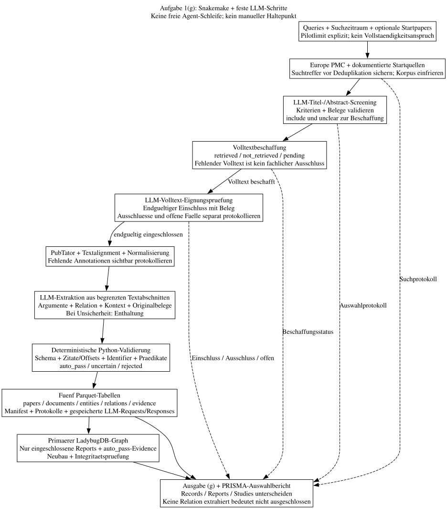
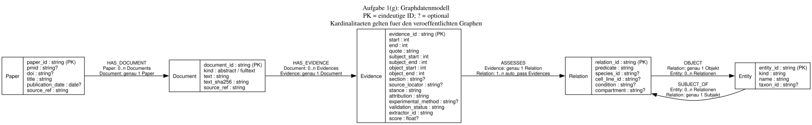

# Früherer LLM-Entwurf für Aufgabe 1(g)

Dieser Entwurf samt Diagrammen beschreibt den früheren LLM-Ablauf. Der Standard wurde auf deterministische Regeln ohne LLM umgestellt. [Aktueller Ablauf, Grenzen und Befehle](../README.md). Die folgenden Entwurfsentscheidungen bleiben zur Nachvollziehbarkeit erhalten und gelten nicht als Beschreibung der aktuellen Screening-/Extraktionsimplementierung.



[DOT-Quelle](diagrams/v1.dot)

## PRISMA im Gesamtprojekt

Die [PRISMA-Dokumentation](prisma/README.md) ergänzt diesen technischen Entwurf um ein [Projektprotokoll](prisma/protocol.md) und [Such-/Entscheidungsprotokolle mit Zählregeln](prisma/tracking.md). PRISMA 2020 und PRISMA-S sind die vorläufige Arbeitsgrundlage; ob PRISMA-ScR zur Forschungsfrage besser passt, ist mit dem Professor festzulegen. Das Protokoll ist ein Entwurf, keine registrierte oder bereits durchgeführte Review-Auswertung.

Vor dem Hauptlauf werden Suchrahmen und Kriterien eingefroren. LLM-Screening, Volltextbeschaffung, Eignungsprüfung und Extraktion sind getrennte Schritte. Der Batch bleibt vollautomatisch; unbeantwortete methodische Fragen und nicht aufgelöste Fälle werden nicht durch erfundene Entscheidungen ersetzt. Technische QC, Extraktionsqualität und wissenschaftliche Evidenzqualität bleiben getrennt.

## Input und automatische Literaturauswahl

Der Nutzereingang besteht aus Suchqueries, Suchzeitraum und optional den vorgegebenen Papers als Startbestand. Synonyme etwa für PER2, TP53/p53, MDM2 und CLOCK/BMAL1 werden berücksichtigt. Die genaue Suchsyntax ist vor Implementierung gegen Europe PMC zu prüfen. Weitere Literaturdienste sind zunächst nicht nötig.

Ein Pilot verarbeitet 20–50 nach dokumentierter Sortierung ausgewählte Papers. Das Limit ist explizit und begründet keinen Vollständigkeitsanspruch. Für die systematische Auswertung werden alle Treffer innerhalb des Suchrahmens erfasst; ein Budget- oder API-Limit muss im Bericht als unvollständige Verarbeitung erscheinen.

Ein LLM erhält Titel, Abstract und festgelegte Ein-/Ausschlusskriterien. Es liefert strukturiert `include`, `exclude` oder `unclear`, eine Kriterien-ID, eine kurze Begründung und eine wörtliche Belegstelle. Das Modell darf die Kriterien nicht verändern. Python prüft Ausgabeschema, Kriterien-ID und Zitat gegen den Eingabetext. Fehlender Abstract oder ungültige Antwort nach begrenzten Wiederholungen führen zu `unclear`, niemals automatisch zu `exclude`. Auch ein formal gültiger Ausschluss kann fachlich falsch sein und muss in der Evaluation berücksichtigt werden.

`screening.csv` wird automatisch als phasenbezogenes Ereignisprotokoll erzeugt, nicht von Hand ausgefüllt. Es trennt `title_abstract`, `retrieval` und `fulltext_eligibility`. Der vollständige [Datenvertrag](prisma/tracking.md) legt Entscheidung, primären Grund, Beleg, Inputstand, Run-ID und mögliche Nachfolgeentscheidung fest. `records.csv` erhält zusätzlich die Suchtreffer vor Deduplikation; der biologische Graph benötigt dafür keine neuen Tabellen.

Die Run-ID verweist auf Eingabe und gespeicherte Modellantwort. Belegstelle und Kriterien-ID dürfen bei technischen Fehlern fehlen; der Fehlergrund bleibt erhalten. Beim Abstract-Screening werden `include` und `unclear` zur Beschaffung weitergeleitet. Das ist noch kein endgültiger Review-Einschluss. Ko-Erwähnung darf zur Vorauswahl dienen, ist aber keine extrahierte Relation. Reviews zählen nicht als eigene experimentelle Bestätigung. Ein einfacher Regelfilter bleibt als Vergleichsbaseline für die Evaluation erhalten, nicht als zusätzlicher harter Ausschluss vor dem LLM. Es gibt keinen manuellen Wartezustand.

## Ablauf

1. Europe-PMC-Suche und Startbestand zusammenführen, deduplizieren und als Korpus einfrieren. Suchparameter, Pagination, Fundwege und Abrufantworten sichern.
2. LLM-Screening mit festen Kriterien durchführen, Antworten validieren und protokollieren. `include` und `unclear` weiterverarbeiten.
3. Verfügbaren strukturierten Volltext abrufen und Beschaffungsstatus protokollieren. Fehlender Volltext ist `not_retrieved`, kein fachlicher Ausschluss. Ein Abstract-Fallback darf nur separat explorativ ausgewertet werden; er ersetzt keine Volltextprüfung.
4. Ein eigener LLM-Schritt prüft die Einschlusskriterien am beschafften Volltext. Nur endgültiges `include` führt in die Primärsynthese; `unclear` und technische Restfälle bleiben offen und werden im Bericht ausgewiesen. Modellantwort und Originalbelege werden wie beim Screening validiert.
5. Für eingeschlossene Reports verfügbare PubTator-Annotationen sichern, Textalignment prüfen und Entitäten normalisieren. Fehlende Annotationen oder mehrdeutige Normalisierungen sichtbar protokollieren, nicht als fehlende biologische Beziehung interpretieren.
6. Ein LLM extrahiert mechanistische Aussagen, Kontext und Evidence aus begrenzten Textabschnitten samt benachbartem Kontext und verfügbaren Entity-Annotationen. Satzübergreifende Aussagen innerhalb dieses Ausschnitts sind erlaubt, unbelegte Ergänzungen nicht. Bei unzureichendem Kontext enthält sich das Modell.
7. Automatische QC ausführen, fünf Parquet-Tabellen veröffentlichen und LadybugDB vollständig neu bauen. Bericht mit Suchabdeckung, technischen Ausfällen, Enthaltungen und PRISMA-Auswahlzahlen erzeugen. Eingeschlossene Reports ohne extrahierte Relation bleiben im Review-Bestand erhalten.

Snakemake orchestriert, Python enthält die Fachlogik. API-Retries sind begrenzt. Nicht verfügbare Einzelpapers werden protokolliert; harte Integritätsfehler verhindern eine Veröffentlichung und führen zu einem fehlgeschlagenen Lauf, nicht zu einem manuellen Review-Wartezustand. Raw-Snapshots und Parquet bleiben die Ergebnisbasis. API-Verträge, Filterqualität, Extraktion und Datenbankimport sind noch ungetestet.

## Begrenzte LLM-Schritte statt freier Agents

Snakemake behält die Kontrolle über die Reihenfolge. Abstract-Screening, Volltext-Eignungsprüfung und Extraktion sind feste Modellaufrufe mit validierter strukturierter Ausgabe, keine selbstplanenden Agent-Schleifen. Anbieter und Modell werden erst anhand einer Evaluation gewählt. Ein Multi-Agent-Framework ist dafür nicht erforderlich.

Der Extractor liefert nur erlaubte Prädikate, Argumentreferenzen, Kontext, Attribution und wörtliche Belege aus seinem Input. Er darf Kandidaten aus vorhandenen Annotationen auswählen, aber keine kanonischen Identifier erfinden. Nicht auflösbare Entitäten bleiben unaufgelöst. Für fehlende Kontextinformationen gilt `null` statt einer Ergänzung aus Modellwissen.

Python übernimmt danach die deterministische Prüfung:

- JSON-Schema, Prädikate, Argumenttypen und Identifier gegen zugelassene Werte prüfen.
- Zitate und Argumentspannen im tatsächlich übergebenen Text lokalisieren; Dokumentoffsets aus dem gespeicherten Chunk-Offset berechnen, nicht vom LLM übernehmen.
- Bei mehrfach vorkommenden Zitaten nur eine durch Abschnitt und Argumentbelege eindeutig bestimmte Stelle verwenden, sonst `uncertain`.
- Kontextbelege ebenfalls im Input prüfen. Alle Belege einer V1-Evidence müssen in einem zusammenhängenden Bereich desselben Dokuments liegen. `quote` speichert dessen vollständigen Originaltext, gegebenenfalls über mehrere Sätze; kein Zusammenkleben entfernter Textstellen.
- Duplikate durch überlappende Chunks entfernen. Chunk-Grenzen, Überlappung und nicht verarbeitete Abschnitte protokollieren; nichts still abschneiden.

Ein vorhandenes Zitat beweist noch nicht, dass es die extrahierte Aussage trägt. Semantische Fehler müssen über die Evaluation gemessen werden. Modell-Selbsteinschätzungen sind keine kalibrierten Scores; `score` bleibt ohne geeignete Messgrundlage leer. Ein zweites Reviewer-LLM ersetzt keinen Goldstandard.

Papertexte und externe Antworten sind untrusted Daten, keine Anweisungen. Modelle erhalten keine Zugangsschlüssel, Shell-, Datei-Schreib- oder Datenbankrechte. Nur der Validator und Graph-Builder können Ergebnisse veröffentlichen. Bei gehosteten Modellen werden ausschließlich Texte übertragen, deren Nutzung dies erlaubt; ausgeschlossene Übertragungen erscheinen als Zugriffslücke.

Konfiguration und Manifest legen Token-/Kostenbudget, Timeout, Parallelität und maximale Versuche fest. Ungültige Extraktionen werden nach begrenzten Wiederholungen verworfen oder als unsicher protokolliert. Ein verbrauchtes Budget markiert den Lauf als unvollständig; es führt weder zu stillen Ausschlüssen noch zu einer unbegrenzten Agent-Schleife. Die satzlokalen Regeln bleiben eine separat ausgewertete Baseline, kein stiller Fallback mit vermischten Ergebnissen.

## Mechanistische Relationen

Für jedes Prädikat werden zulässige Argumenttypen, Richtung, Regeln und Beispiele festgelegt. Die fachliche Definition geschieht vor dem Lauf, nicht durch Einzelfallentscheidungen während der Verarbeitung.

| Prädikat | Bedeutung |
|---|---|
| `UPREGULATES`, `DOWNREGULATES` | erhöht beziehungsweise senkt die Expression des Ziels |
| `BINDS` | physische Bindung; symmetrisch, Argumentreihenfolge wird kanonisiert |
| `STABILIZES` | erhöht die Stabilität des Zielproteins |
| `UBIQUITINATES` | ubiquitiniert das Zielprotein |
| `PROMOTES_DEGRADATION` | fördert den Abbau des Zielproteins |
| `PROMOTES_NUCLEAR_IMPORT` | fördert den Import des Zielproteins in den Zellkern |

Ubiquitinierung impliziert nicht automatisch beobachteten Abbau. Expression, Aktivität und Stabilität werden nicht gleichgesetzt. Gen und Protein sowie unterschiedliche Species bleiben getrennte Entitäten. Komplexaussagen wie CLOCK:BMAL1 werden ohne eindeutige Komplexidentität als nicht unterstützt protokolliert, nicht in unbelegte Einzelbeziehungen zerlegt.

## Fünf Tabellen

`?` kennzeichnet ein optionales Feld. Abstract und Volltext brauchen eigene Dokumentidentitäten und Offsets; Text liegt deshalb nur auf Document.

| Tabelle | Felder |
|---|---|
| `papers` | `paper_id`, `pmid?`, `doi?`, `title`, `publication_date?`, `source_ref` |
| `documents` | `document_id`, `paper_id`, `kind`, `text`, `text_sha256`, `source_ref` |
| `entities` | `entity_id`, `kind`, `name`, `taxon_id?` |
| `relations` | `relation_id`, `subject_id`, `predicate`, `object_id`, `species_id?`, `cell_line_id?`, `condition?`, `compartment?` |
| `evidence` | `evidence_id`, `relation_id`, `document_id`, `start`, `end`, `quote`, `subject_start`, `subject_end`, `object_start`, `object_end`, `section?`, `source_locator?`, `stance`, `attribution`, `experimental_method?`, `validation_status`, `extractor_id`, `score?` |

- `paper_id` verwendet bevorzugt PMID, sonst normalisierte DOI. Später gefundene Identifier ergänzen die Identität. Konflikte und nicht auflösbare Identitäten werden mit Quellreferenz protokolliert und von der Graphübernahme ausgenommen.
- `document_id` identifiziert Paper, Dokumentart (`abstract` oder `fulltext`), Quellinhalt und Parserversion. Neue Textstände erzeugen neue IDs. `source_ref` verweist auf Quelle, Lizenz und Hash im Raw-Abrufmanifest.
- `entity_id` ist eine kanonische ID mit Namespace, etwa NCBI Gene oder UniProt. Mehrdeutige Zuordnung führt zur Enthaltung.
- `relation_id` ist ein Hash der kanonischen Argument-IDs, des Prädikats und aller vier Kontextfelder. Kanonisierungsregeln und Prädikatsdefinitionen sind versioniert; Paperlisten und Modellversionen gehören nicht in die Relation.
- Eine Evidence bewertet eine Relation anhand einer Stelle in einem Document. Ihre ID berücksichtigt Relation, Dokument-ID, Spans und Extractor-Version. Das Paper ergibt sich über Document.
- Spans zählen Unicode-Codepoints im gespeicherten Text, halboffen als `[start, end)`. `text[start:end]` muss exakt `quote` entsprechen. Argumentspannen referenzieren denselben Text. Section und Quelllocator bleiben optionale Properties.
- `stance` beschreibt die extrahierte textuelle Haltung: `supports`, `refutes` oder `inconclusive`. V1 veröffentlicht keinen automatisch behaupteten biologischen Widerspruch; potenzielle Zurückweisungen bleiben als `inconclusive` mit Begründung im QC-Protokoll erhalten. `refutes` ist vorerst reserviert.
- `validation_status` ist `auto_pass`, `uncertain` oder `rejected`. Es ersetzt `review_status`: `auto_pass` bedeutet bestandene automatische Prüfungen, keine menschliche Begutachtung.
- `attribution` ist `own_experiment`, `model_prediction`, `cited_result`, `review_summary` oder `unknown`. Ohne ausreichende Textbelege bleibt sie `unknown`. Ein Score beschreibt die Extraktion, keine biologische Wahrheitswahrscheinlichkeit.

## Graphdatenmodell



[DOT-Quelle des Graphschemas](diagrams/graph_schema.dot)

Parquet-Fremdschlüssel werden zu Kanten: `documents.paper_id` zu `HAS_DOCUMENT`, `evidence.document_id` zu `HAS_EVIDENCE`, `evidence.relation_id` zu `ASSESSES`, `subject_id` zu `SUBJECT_OF` und `object_id` zu `OBJECT`. Sie müssen nicht zusätzlich als Properties gespeichert werden. Derselbe Entity-Typ dient als Subjekt und Objekt, auch bei Autoregulation.

Nur `auto_pass`-Evidence aus endgültig eingeschlossenen Reports wird in den primären Graph übernommen; jede Relation im Graph hat mindestens eine solche Evidence. Die Einschlussliste liegt im Auswahlprotokoll und wird beim Build geprüft. Explorative Abstract-Auswertungen gehören in einen separat gekennzeichneten Dataset-/Graph-Stand, nicht in die Primärsynthese. Andere Kandidaten bleiben, sofern strukturell gültig, in Parquet. Fälle ohne auflösbare Argumente oder gültige Textspannen stehen im QC-Protokoll statt in fehlerhaften Tabellenzeilen. Der Build prüft Kardinalitäten und Integrität. Kontext bleibt auf Relation, Methode auf Evidence. Manifeste und Protokolle bleiben außerhalb des Graphen; ein Graph gehört zu einem Dataset-Stand.

## Kontext und Grenzen

Species, Zelllinie, Bedingung und Kompartiment werden nur bei belegter Zuordnung übernommen. `species_id` beschreibt das Versuchssystem, `taxon_id` die Entity. Gemischte Systeme, komplexe Zeitabhängigkeit, Spekulation und unklare Negation führen zur Enthaltung oder zu `uncertain`. Eine mechanistische Edge ersetzt kein dynamisches Modell.

Unbekannter Kontext ist kein Wildcard-Match. Gleiche unvollständige Felder beweisen keine vergleichbaren Experimente. Nicht abbildbare Unterschiede bleiben im Quelltext erhalten. Gegensätzliche Ergebnisse sind höchstens Widerspruchskandidaten. Negation bedeutet nicht die umgekehrte Regulation; ein nicht signifikanter Effekt beweist keine Widerlegung.

Aus `auto_pass`, `stance=supports` und `attribution=own_experiment` werden verschiedene Papers gezählt. Die Kennzahl heißt maschinell zugeordnete Unterstützung, nicht bestätigte Replikation. Abstract/Volltext-Duplikate, Reviews und mehrere Extractor-Läufe sind keine zusätzlichen Bestätigungen. Modellvorhersagen und unbekannte Attribution werden getrennt ausgewiesen.

## Ablage und Reproduzierbarkeit

```text
data/
  raw/<snapshot>/          # unveränderte Antworten und Texte + Abrufmanifest
  runs/<run-id>/
    manifest.json
    records.csv           # Suchtreffer vor Deduplikation
    screening.csv         # phasenbezogene Auswahl-/Beschaffungsereignisse
    prisma_counts.json    # berechnete Zahlen und offene Restmengen
    qc.json               # Fehler, Enthaltungen und Zählwerte mit Quellreferenzen
    llm/                  # Requests, Responses und Aufrufprotokoll
    papers.parquet
    documents.parquet
    entities.parquet
    relations.parquet
    evidence.parquet
```

Das Raw-Abrufmanifest speichert Queries, Zeitraum, Suchdatum, Parameter, Trefferzahlen, Paper-IDs, Fundwege, API-Version soweit bekannt, Abrufstatus, Lizenzen und Antwort-Hashes. Fehlende Texte und Annotationen bleiben sichtbar. Zugangsschlüssel werden nicht gespeichert.

`manifest.json` enthält Schema-/Pipeline-Version, Code-Stand einschließlich lokaler Änderungen, Protokoll-Hash und Änderungsstand, Konfiguration, Dependency-Lock-Hash, Referenzdatenstände, Screeningkriterien, aktive Entscheidungsereignisse, Input-/Output-Dateihashes und Extractor-Versionen. Für LLMs werden Anbieter, exakte Modellkennung/Revision soweit verfügbar, Prompt-Version und vollständiger Prompt, Ausgabeschema, Parameter, Chunking-Version und Budgets gespeichert. Nicht offengelegte Modellrevisionen bleiben ausdrücklich unbekannt.

Unter `llm/` bleiben vollständige Requests und Responses einschließlich ungültiger Versuche erhalten, ohne Zugangsschlüssel. Das Aufrufprotokoll verknüpft Run-ID, Paper/Dokument und Chunk-Spans, Input-Hash, Prompt-/Modellstand, Zeitpunkt, Versuch, Status, Tokenverbrauch und Kosten soweit verfügbar. Es ordnet veröffentlichte Evidence-IDs den ausgewählten Responses zu. `extractor_id` und `screening_run_id` verweisen auf diese Provenance, ohne zusätzliche Graph-Nodes.

Der Cache-Schlüssel berücksichtigt Inputinhalt, Prompt, Modellrevision, Ausgabeschema und Parameter. Offline-Replay nutzt die im Run festgehaltenen Antworten und wiederholt Validierung und Graph-Build, ohne Live-Suche oder Modellaufrufe. Ein frischer LLM-Aufruf kann auch bei Temperatur 0 anders ausfallen und erzeugt einen neuen Run. Reproduzierbarkeit bedeutet hier Replay gespeicherter Antworten, nicht garantierte Neugenerierung identischer Texte. Verglichen werden logische Tabelleninhalte, nicht byteidentische Parquet- oder Graphdateien.

## QC, Evaluation und Abgabe zu (g)

Automatische Prüfungen decken IDs, Fremdschlüssel, Spans, Argumenttypen, Prädikate und Kontextkonsistenz ab. Der Graph muss Zähl-, Integritäts- und Beispielabfragetests bestehen. Diese Prüfungen ersetzen keine Messung der fachlichen Extraktionsqualität.

Ein vorhandener, separat erstellter Goldstandard kann automatisch ausgewertet werden. Er muss nach Papers getrennte positive und negative Beispiele sowie vollständig annotierte Passagen enthalten. Abstract und Volltext desselben Papers bleiben im selben Split. Damit lassen sich Screeningfehler einschließlich fälschlich ausgeschlossener Papers sowie Precision und Recall der Extraktion messen. Das Erstellen oder fachliche Prüfen eines Goldstandards ist eine separate Forschungsaufgabe, kein Haltepunkt jedes Pipeline-Laufs.

Regelbaseline und LLM-Variante werden auf demselben eingefrorenen Korpus und Testsplit verglichen. Gemessen werden insbesondere Screening-Recall einschließlich ausgeschlossener Papers, Argumente, Relationsrichtung, Prädikat, Kontext und Attribution sowie Enthaltungsrate, Laufzeit und Kosten pro Paper. Screening und Extraktion werden getrennt und zusätzlich als Gesamtablauf bewertet. Testpapers dürfen weder zur Promptoptimierung noch zur Auswahl von Few-Shot-Beispielen dienen.

Ohne passenden Goldstandard berichtet der Lauf ausdrücklich `nicht evaluiert`, keine erfundene Precision, Recall oder Confidence-Kalibrierung. Die vorgegebenen Kernpapers dienen nur als Abdeckungskontrolle; ihr Wiederfinden allein belegt keine ausreichende Suchqualität.

Die automatische Ausgabe für (g) umfasst Such-/Auswahlprotokolle, Ausschlussgründe, Evidenztabelle mit Originalstellen, biologischen Graphen sowie einen Bericht zu Abdeckung, Ausfällen, Enthaltungen und verfügbaren Qualitätsmessungen. PRISMA-Zahlen und das spätere offizielle Flussdiagramm werden aus den Protokollen berechnet, nicht aus Graphgrößen. Records, Reports und Studies werden getrennt gezählt; ohne belastbare Studienzuordnung bleibt die Studienzahl unbestimmt. Das Flussdiagramm ist ein Ergebnisartefakt, kein zusätzliches Architekturdiagramm. Die anwendbaren PRISMA-Items einschließlich wissenschaftlicher Bias-/Evidenzbewertung müssen im gesamten Projektbericht behandelt werden; ein automatisch erzeugter Graph erfüllt diese Anforderungen nicht allein. Ein Pilot, fehlende Volltexte oder ein enges Regelvokabular erlauben keinen Vollständigkeitsanspruch. Der unbeaufsichtigte Betrieb ist das Ziel; wissenschaftliche Aussagekraft bleibt an gemessene Qualität und dokumentierte Grenzen gebunden.

## Agentisches Nachlesen: optional und später

Erst wenn die Evaluation fehlenden Kontext als relevante Fehlerquelle zeigt, kann ein begrenzter Agent unklare Extraktionen ergänzen. Er darf Abschnitte eines bereits gespeicherten Papers suchen und lesen, vorhandene Annotationen abrufen und eine strukturierte Extraktion oder Enthaltung zurückgeben. Er nutzt denselben Validator. Maximale Toolaufrufe, Tokens, Laufzeit und Kosten sind festgelegt; jede Toolaktion und Antwort wird für Replay gespeichert. Keine direkten Graph-Schreibrechte, keine freie Shell und keine autonome Änderung der Einschlusskriterien.

Eine autonome Erweiterung der Literatursuche gehört nicht zur V1. Später darüber gefundene Papers müssten getrennt von der festen Basissuche markiert werden, einschließlich Suchaktionen, Fundweg und Abbruchregeln. Sonst drohen Suchdrift und Bestätigungsbias. Ein Agent wird nur bei gemessenem Nutzen gegenüber festen LLM-Schritten ergänzt.

## Bewusst vertagt

Keine eigenen Section-, Sentence-, Context-, ModelRun- oder PipelineRun-Tabellen. Kein Multi-Agent-System, Citation-/Author-Graph, GROBID, Embedding, GraphRAG, UI oder inkrementelles Graph-Update. Die fünf Tabellen und das Graphschema bleiben durch den LLM-Einsatz unverändert.

## Diagramme rendern

Vom Projektverzeichnis aus:

```sh
dot -Tsvg code/text_mining/docs/diagrams/v1.dot -o code/text_mining/docs/diagrams/v1.svg
dot -Tsvg code/text_mining/docs/diagrams/graph_schema.dot -o code/text_mining/docs/diagrams/graph_schema.svg
```
