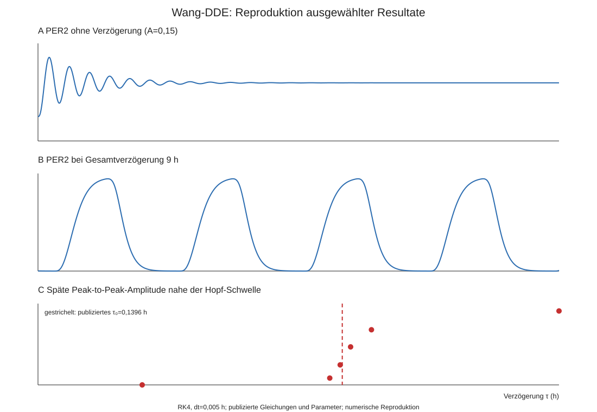

# Task 1

## Exercise 1

### a)

#### Summary

##### Abstract

1. Circadiane Uhr und Zellzyklus sind gekoppelt und stimmen Stoffwechsel,
   Zellteilung und Stressantwort zeitlich aufeinander ab.
2. Im Mittelpunkt steht das Netzwerk aus dem Uhrprotein PER2, dem
   Tumorsuppressor p53 und dessen negativem Regulator MDM2.

##### Introduction

1. Die circadiane Uhr erzeugt über Rückkopplungsschleifen einen Rhythmus von
   ungefähr 24 Stunden und steuert dadurch viele zelluläre Prozesse.

##### Coupling Between the Circadian Clock and Cell Division Cycle

1. Uhrproteine öffnen bestimmte Zeitfenster für Zellzyklusübergänge und
   verbinden den Tagesrhythmus mit Kontrollpunkten für DNA-Schäden.
2. PER2 bindet p53, schützt es vor der MDM2-vermittelten Ubiquitinierung und dem
   Abbau und fördert seinen Import in den Zellkern.
3. p53 ist im Zellkern deutlich stabiler als im Cytoplasma, sodass der durch
   PER2 geförderte Kernimport p53 zusätzlich schützt.
4. Trotz dieser Stabilisierung schwingen PER2 und p53 im Cytoplasma und im
   Gesamtlysat gegenphasig, im Zellkern aber gleichphasig. Das ist das
   Gegenphasen-Paradox.

##### An Unbiased Systematic Modeling Approach

1. Ein vereinfachtes ODE-Modell beschreibt p53 und PER2 getrennt in Cytoplasma
   und Zellkern sowie Produktion, Import, Export und Abbau.
2. Sehr viele mögliche positive, negative oder fehlende Regulationen wurden
   simuliert und mit den gemessenen Zeitreihen verglichen.
3. Erfolgreiche Modelle sagten voraus, dass PER2 den Kernimport von p53 fördert,
   p53 im Kern stabiler ist und PER2 auch ubiquitiniertes p53 binden kann.

##### From in silico Prediction to in vitro Validation

1. Zell- und Proteinexperimente bestätigten alle drei Vorhersagen und lösten
   damit das Gegenphasen-Paradox auf.

##### A Bidirectional Relationship Between Clock and Checkpoint Components

1. PER2 schützt p53 vor MDM2.
2. Umgekehrt ubiquitiniert MDM2 auch PER2 und führt zu dessen Abbau.
3. So entsteht eine Rückkopplung zwischen circadianer Uhr und
   Zellzyklus-Kontrollpunkt.

##### Schlussfolgerung

1. Die DNA-Schadensantwort kann von der Tageszeit abhängen.
2. Deshalb könnten p53-gerichtete Therapien zu bestimmten Tageszeiten wirksamer
   sein (Chronotherapie).

### b)

#### Vergleich der Netzwerk- und dynamischen Modelle

[Zou et al. (2020)](sources/zou_2020_circadian_cell_cycle_checkpoints.pdf)
behandeln die Kopplung von circadianer Uhr und Zellzyklus-Checkpoints auf
unterschiedlichen Beschreibungsebenen. Die folgende Diskussion gibt die Modelle
und experimentellen Befunde nach diesem Review wieder; eigene Simulationen
wurden nicht durchgeführt.

| Modell | Beschreibung und Aussagekraft | Grenzen |
|---|---|---|
| Qualitatives Netzwerk, Abb. 2 | Verbindet PER2-vermittelten p53-Schutz und Kerntransport mit der Freisetzung aktiven p53 und MDM2-vermitteltem PER2-Abbau. Zeigt die bidirektionale Kopplung von Uhr und Checkpoint. | Die Pfeile allein liefern weder eine vollständige Parametrisierung noch berechenbare Konzentrationskurven oder Periodenlängen. |
| Kim–Forger-Uhrmodell | Liefert die simulierten circadianen PER-Verläufe als Eingang für das vereinfachte p53-Modell. | Diese Verwendung beschreibt noch keine vollständige Rückwirkung des Checkpoints auf die Uhr. |
| Vereinfachtes ODE-Modell, Gl. 1–2, Abb. 1C–F | Zwei Differentialgleichungen beschreiben cytoplasmatisches und nukleäres p53. Für Synthese, Kernimport, Kernexport und Abbau in beiden Kompartimenten werden positive, negative oder fehlende PER2-Einflüsse getestet. | Die effektiven Regulationsfunktionen legen den zugrunde liegenden molekularen Mechanismus nicht eindeutig fest. |
| Verfeinertes Modell, Abb. 1G | Enthält laut Review 13 Differentialgleichungen und 18 Parameter. Ergänzt PER-Rückkopplung, PER2–p53-Bindung und unterschiedliche Ubiquitinierungszustände. | Mehr Details benötigen zusätzliche Annahmen und Parameter; ein passender Verlauf beweist keine einzigartige Modellstruktur. |

Das vereinfachte Modell bevorzugt PER2-geförderten Kernimport und eine höhere
p53-Stabilität im Kern. Das verfeinerte Modell beschreibt mögliche molekulare
Mechanismen dafür: PER2 schützt p53 vor Ubiquitinierung im Kernimportmotiv;
cytoplasmatisches monoubiquitiniertes p53 wird durch Polyubiquitinierung instabil.
Es liefert außerdem die Vorhersage, dass PER2 auch ubiquitiniertes p53 bindet.
Die beiden Modellstufen bauen aufeinander auf und widersprechen sich nicht.
Das Netzwerk aus Abb. 2 ist dabei nicht automatisch mit dem implementierten
Reaktionsumfang des verfeinerten ODE-Modells gleichzusetzen.

#### Conflicting hypotheses

Der zentrale scheinbare Widerspruch besteht darin, dass PER2 p53 stabilisiert,
beide Proteine im Cytoplasma und Gesamtlysat aber weitgehend gegenphasig
oszillieren. Aus dem Schutz vor Abbau wäre zunächst ein gleichphasiger Verlauf
zu erwarten gewesen. Im Kern wird dieser auch beobachtet (Abb. 1A–C).
Kerntransport und kompartimentspezifischer Abbau erklären, weshalb die einfache
Erwartung für das Gesamtsystem nicht ausreicht. Der Stabilisierungseffekt selbst
wird dadurch nicht widerlegt.

Im vereinfachten Modell konkurrieren verschiedene Regulationsvarianten. Von
ungefähr einer Million simulierten Szenarien reproduzieren laut Review 1.000 die
beobachteten Phasenbeziehungen. Erfolgreiche Modelle bevorzugen positiven
Kernimport und höhere nukleäre Stabilität (Abb. 1D–F). Experimentell verändert
PER2-Manipulation die nukleäre p53-Anreicherung; die p53-Halbwertszeit ist im Kern
ungefähr siebenmal länger als im Cytoplasma. Nach PER2-Absenkung bleibt jedoch
p53 im Kern nachweisbar, sodass weitere Transportwege möglich bleiben
(Abschnitt "From in silico Prediction to in vitro Validation").

| Weiterer scheinbarer Gegensatz | Einordnung |
|---|---|
| PER2 verhindert p53-Ubiquitinierung, bindet aber auch ubiquitiniertes p53. | Schutz vor weiterer Modifikation und Bindung an bereits modifiziertes Protein sind vereinbar. Die Bindung an mono- und polyubiquitiniertes p53 wird durch Proteinassays gestützt (Abb. 1G, Prediction 3). |
| PER2 stabilisiert p53, hemmt aber dessen Aktivität im gebundenen Zustand. | Stabilität und Transkriptionsaktivität sind verschiedene Eigenschaften. Ein stabiler gebundener Vorrat kann zunächst inaktiv sein; dauerhaft gekoppelte Chimären stützen diese Unterscheidung ("Coupling Between..."; Abb. 2). |
| PER2-Abbau benötigt Phosphorylierung, erfolgt aber auch ohne sie. | Der CK1/β-TrCP-Weg benötigt PER2-Phosphorylierung, der MDM2-Weg nicht. Dies widerspricht einer Ausschließlichkeitsannahme; beide Wege können nebeneinander wirken ("A Bidirectional Relationship Between Clock and Checkpoint Components"). |

Nicht jede dieser Gegenüberstellungen ist eine von verschiedenen Autoren
vertretene konkurrierende Theorie. Teilweise werden vereinfachte Annahmen durch
zusätzliche Prozesse oder Zustände präzisiert.

#### Bewertung

Die experimentellen Prüfungen stützen konkrete Modellvorhersagen. Die
Übereinstimmung simulierter und gemessener Phasen allein reicht dagegen nicht
als Mechanismusbeweis: Mehrere Modelle können dieselben Beobachtungen erklären.
Der Review bezeichnet die wenigen verfügbaren Zeitreihen ausdrücklich als
unzureichend für eine eindeutige Bestimmung des Systems. Auch die zunächst
gleichberechtigte Auswahl positiver, negativer und fehlender Regulation macht
die Untersuchung nicht voraussetzungsfrei. Die Auswahl der Prozesse und
Funktionsformen bleibt eine Modellannahme.

### c)

#### Entwicklung der Befunde und Modelle

Die vier vorgegebenen Arbeiten erweitern die Verbindung zwischen circadianer
Uhr und Checkpoint schrittweise. Dabei müssen experimentelle Befunde,
mechanistische Hypothesen und klinische Einordnung getrennt werden. Die
Arbeiten stammen aus einer überlappenden Forschungsgruppe und bilden daher
keine Kette unabhängiger Replikationen.

##### Gotoh et al. (2014): PER2 stabilisiert p53

[Gotoh et al. (2014)](sources/gotoh_2014_period2_p53_stability.pdf) zeigen,
dass PER2 direkt an p53 bindet und dessen MDM2-vermittelte Ubiquitinierung
vermindert. Ein PER2–p53–MDM2-Komplex ist nachweisbar; nach PER2-Knockdown nimmt
die p53-Halbwertszeit ab (Abb. 1–3). PER2-Überexpression erhöht außerdem
TP53-mRNA und in HCT116-Zellen mehrere p53-Zieltranskripte. Die Antwort hängt
vom Zielgen und Zellkontext ab (Abb. 3C, 4).

Daraus entsteht das qualitative Priming-Modell: PER2 erhält einen basalen
p53-Vorrat, der für eine spätere Stressantwort verfügbar sein könnte (Abb. 5).
Experimentell gezeigt sind Bindung, Ubiquitinierungsschutz und Stabilisierung.
Die stressabhängige Freisetzung des Vorrats ist hier noch eine Hypothese.
Ein parametrisiertes dynamisches Modell wird nicht entwickelt.

##### Gotoh et al. (2015): Stabilisierung und Aktivierung werden getrennt

[Gotoh et al. (2015)](sources/gotoh_2015_period2_p53_dna_damage.pdf) ergänzen
die räumliche und funktionelle Organisation. In den untersuchten HCT116-Zellen
liegt der PER2–p53-Komplex in Cytoplasma und Kern vor, der Dreierkomplex mit MDM2
dagegen nur im Kern (Abb. 1). Kovalente p53–PER2-Chimären bilden eine dauerhaft
erzwungene Bindung nach. Diese Konstrukte zeigen verminderte Ubiquitinierung,
können aber die untersuchte p21-Zielgenantwort auch nach Bestrahlung nicht wie
freies p53 auslösen. Zusätzliche Kernlokalisation allein stellt die Aktivität
nicht wieder her (Abb. 2–5).

Das Modell unterscheidet nun einen stabilen, gebundenen und zunächst inaktiven
p53-Vorrat von freiem, aktivierbarem p53 (Abb. 6). Damit wird die
Freisetzungshypothese funktionell gestützt. Wann und wodurch endogene Komplexe
auseinandergehen, bleibt offen; die künstliche Dauerbindung ist kein direkter
Nachweis des vollständigen physiologischen Ablaufs.

Dies widerspricht den erhöhten Zieltranskripten von 2014 nicht grundsätzlich:
PER2-Überexpression lässt einen freien p53-Anteil zu, während die Chimäre
Dauerbindung erzwingt. Auch Zellhintergrund und Messbedingungen unterscheiden
sich. Die Erweiterung betrifft ein qualitatives Reaktionsschema, keine neue
vollständig parametrisierte ODE-Beschreibung.

##### Selfridge et al. (2016): Einordnung in die Chronotherapie

[Selfridge et al. (2016)](sources/selfridge_2016_chronotherapy.pdf) ordnen die
molekularen Verbindungen in zeitabhängige Arzneimittelwirkungen ein. Circadiane
Rhythmen beeinflussen sowohl Zielstrukturen und Gewebereaktionen als auch
Aufnahme, Verteilung, Metabolisierung und Ausscheidung von Arzneimitteln
(Abschnitte 2 sowie 4–6, Abb. 1–2).

Der Beitrag ist ein narrativer Review mit einer Bestandsaufnahme registrierter
Studien. Er liefert weder eine unabhängige Replikation der Gotoh-Befunde noch
ein neues parametrisiertes Uhr–p53-Modell. Die Entwicklung besteht hier in der
klinischen Einordnung: Die Mechanismen begründen die Untersuchung geeigneter
Behandlungszeiten. Ein optimaler Zeitpunkt für eine spezifische PER2/p53-Therapie
ist damit nicht nachgewiesen. Wirkstoff, Darreichungsform und individuelle
Rhythmen begrenzen pauschale Empfehlungen (Abschnitte 7–8).

##### Liu et al. (2018): Rückwirkung des Checkpoints auf die Uhr

[Liu et al. (2018)](sources/liu_2018_period2_mdm2.pdf) weisen PER2 als Substrat
der E3-Ligase MDM2 nach. PER2–MDM2-Bindung ist auch ohne p53 nachweisbar.
MDM2-vermittelte PER2-Ubiquitinierung setzt keine vorherige
PER2-Phosphorylierung voraus und ergänzt damit den CK1/β-TrCP-Weg
(Abb. 1–4). MDM2-Überexpression fördert PER2-Abbau und verkürzt die circadiane
Periode; MDM2-Knockdown beziehungsweise Ligasehemmung stabilisieren PER2 und
verlängern die Periode in den untersuchten Zellmodellen (Abb. 5–6).

Damit wird die Rückrichtung experimentell gestützt: Ein Checkpoint-Regulator
beeinflusst ein Uhrprotein und den Rhythmus. Das zuvor auf PER2-vermittelte
p53-Regulation konzentrierte Bild erweitert sich zu einer bidirektionalen
Kopplung. Die Arbeit nutzt zusätzlich Strukturmodellierung und Docking, entwickelt
aber kein neues dynamisches ODE-Modell des gesamten Netzwerks. Aus der
p53-unabhängigen Bindung folgt außerdem keine nachgewiesene p53-Unabhängigkeit
aller Periodeneffekte.

#### Gesamtbewertung

Die Entwicklung führt vom stabilisierten p53-Vorrat über die Trennung von
Stabilität und Aktivität zur experimentell gestützten Rückwirkung von MDM2 auf
PER2. Selfridge 2016 ergänzt die klinische Perspektive, ohne selbst den nächsten
mechanistischen Nachweis zu liefern. Die Arbeiten erweitern daher überwiegend
ein gemeinsames Netzwerkmodell, statt einander zu widerlegen.

Die in 1(b) diskutierten ODE-Modellstufen werden im Zou-Review insbesondere
Gotoh et al. (2016) zugeschrieben. Diese zusätzliche Originalarbeit gehört nicht
zu den vier in 1(c) aufgeführten Publikationen und darf nicht mit Selfridge 2016
verwechselt werden. Aus den Zellkultur- und Proteinexperimenten der vorgegebenen
Arbeiten folgt noch keine allgemeine Gültigkeit in sämtlichen Geweben oder eine
klinisch validierte Therapie. Dieser Vergleich der vorgegebenen Literatur ist
keine abgeschlossene systematische Suche oder PRISMA-Auswertung.

### d)

#### Historische Entwicklung außerhalb der Finkielstein-Gruppe

Die Verbindung zwischen circadianem System und Krebs wurde auf verschiedenen
Ebenen untersucht: tageszeitliche Zellproliferation, Licht- und
Schichtarbeitsbedingungen, das Uhrsystem des Gesamtorganismus und schließlich
spezifische Uhrgene. Eine historische Prioritätsaussage muss deshalb den
jeweiligen Befund genau benennen. Die erste Beobachtung rhythmischer
Zellproliferation ist beispielsweise nicht gleichbedeutend mit dem ersten
Nachweis einer molekularen PER2–p53-Verbindung.

Die folgende Auswahl beruht auf einer begrenzten, dokumentierten API- und
Referenzrecherche außerhalb der Finkielstein-Gruppe. "Abstract" und "Volltext"
kennzeichnen die hier tatsächlich geprüfte Quellenebene; bei Volltexten wurden
Text und relevante Abbildungslegenden, aber nicht sämtliche Bilddaten und
Supplemente geprüft. Die aufgeführten Arbeiten sind historische Beiträge,
keine durch eine vollständige Rückwärtssuche gesicherten Erstentdeckungen.

| Arbeit | Historischer Befund und experimenteller Kontext | Einordnung der Priorität / Quellenebene |
|---|---|---|
| [Buchi et al. 1991](https://europepmc.org/article/MED/2065918) | Circadianer Verlauf des Thymidineinbaus in menschlichen Rektumbiopsien als Maß der Zellproliferation. | Früher Beobachtungsbefund zur Rhythmik, noch kein molekularer Uhr–Checkpoint-Mechanismus. Abstract. |
| [Bjarnason et al. 1999](https://europepmc.org/article/MED/10027418) | Tageszeitliche Unterschiede nukleärer p53-Expression und anderer Zellzyklusproteine in menschlicher Mundschleimhaut. | Die Autoren bezeichnen die circadiane p53-Variation ausdrücklich als neu. Dieser Neuheitsanspruch wurde nicht gegen sämtliche frühere Literatur geprüft; er betrifft keine direkte PER2–p53-Bindung. Abstract. |
| [Anderson et al. 2000](https://europepmc.org/articles/PMC7127503) | Einfluss von Dauerlicht auf DMBA-induzierte Mammatumoren bei Ratten. Unter diesem Protokoll hatten 8/50 Tiere bei Dauerlicht gegenüber 19/50 bei Licht-Dunkel-Wechsel Tumoren. | Belegt eine ältere experimentelle Licht–Tumor-Forschungslinie. Kein spezifischer Uhrgenversuch und kein allgemeiner Nachweis einer Schutzwirkung von Dauerlicht. Volltext, Results/Table 1 und Discussion. |
| [Hansen 2001](https://europepmc.org/article/MED/11138824) | Fall-Kontroll-Studie: Nachtarbeit war mit höherem Brustkrebsrisiko assoziiert. | Epidemiologische Evidenz vor den PER2-Experimenten; eine Assoziation beweist keinen bestimmten molekularen Mechanismus. Abstract. |
| [Filipski et al. 2002](https://europepmc.org/article/MED/11983758) | Nach Läsion des suprachiasmatischen Nukleus wuchsen transplantierte Tumoren bei Mäusen schneller als nach Scheinoperation. | Bereits vor Fu 2002 ein experimenteller Beitrag zur Uhr des Wirts und Tumorprogression. SCN-Läsion und transplantierte Tumoren sind von Uhrgenmutation und Tumorentstehung zu unterscheiden. Abstract. |
| [Fu et al. 2002](https://europepmc.org/article/MED/12372299) | mPer2-defiziente Mäuse zeigten erhöhte Tumorneigung, mehr Tumorentwicklung nach Gammabestrahlung und verminderte Thymozytenapoptose. | Spezifischer früher Beitrag zur PER2-Tumorsuppressionshypothese in vivo; keine Erstentdeckung der gesamten Uhr–Krebs-Verbindung. Abstract. |
| [Matsuo et al. 2003](https://europepmc.org/article/MED/12934012) | Circadiane Regulation von wee1 und mitoserelevanter Cyclin-B1-Cdc2-Aktivität in regenerierender Mausleber. | Molekularer Mechanismus der Zellzykluskopplung, keine erstmalige Beobachtung von Teilungsrhythmen. Abstract; die spezifische CLOCK/BMAL1-Zuordnung ist hier zusätzlich durch Zou 2020 sekundär belegt. |
| [Gery et al. 2006](https://europepmc.org/article/MED/16678109) | PER1-Manipulation beeinflusste DNA-schadensinduzierte Apoptose in humanen Krebszellen; berichtet wurde außerdem eine Interaktion mit ATM und CHK2. | Spezifischer PER1-/Checkpoint-Beitrag, dessen funktionelle Reproduzierbarkeit später gezielt geprüft wurde. Abstract. |
| [Gréchez-Cassiau et al. 2008, online 2007](https://europepmc.org/article/MED/18086663) | Bmal1-Verlust erhöhte die p21-Expression, hob deren Rhythmik auf und verminderte die Proliferation primärer Hepatozyten; p21-siRNA kehrte den Proliferationsphänotyp um. | Mechanistische Erweiterung um BMAL1/p21. Der Rescue innerhalb derselben Arbeit ist keine unabhängige Replikation. Abstract. |

Die Priorität verteilt sich somit auf unterschiedliche Aussagen. Fu 2002 ist
für die spezifische PER2-Hypothese relevant, Matsuo 2003 für einen
Zellzyklusmechanismus und Gery 2006 für PER1-abhängige Schadensantworten.
Keine dieser Arbeiten kann pauschal als erste Entdeckung des Zusammenhangs
zwischen circadianem System und Krebs bezeichnet werden. Schon die geprüften
älteren Arbeiten schließen diese breite Zuschreibung aus.

#### Bestätigung, Erweiterung und Gegenbefunde

| Ausgangsbefund / spätere Arbeit | Ergebnis und Bewertung |
|---|---|
| Licht und Tumoren: Anderson 2000 gegenüber älteren Dauerlichtversuchen | Anderson berichtet geringere Tumorlast und bezeichnet das Ergebnis ausdrücklich als unvereinbar mit einem zuvor berichteten Anstieg bei Shah et al. 1984. Zugleich unterscheiden sich Expositionsbeginn, Rattenstamm und DMBA-Protokoll. Shah wurde hier nur über Anderson gelesen. Deshalb ein dokumentierter Ergebnisgegensatz, aber keine von uns nachgewiesene protokollgleiche Falsifikation. |
| PER1 und Krebszellwachstum: [Gery et al. 2007](https://europepmc.org/article/MED/17332281) | PER1-Expression war in nichtkleinzelligem Lungenkrebs vermindert; forcierte Expression reduzierte Wachstum und klonogenes Überleben. Dies stützt eine wachstumshemmende PER1-Funktion, stammt jedoch aus einer überlappenden Autorengruppe und repliziert nicht automatisch die ATM/CHK2-Strahlenantwort. Abstract. |
| Uhr und Zellzyklus: [Dickmeis et al. 2007](https://europepmc.org/articles/PMC1828142) | Bei Zebrafischlarven beeinträchtigte ein Cortisoldefizit die Proliferationsrhythmik trotz fortbestehender Uhrgenrhythmen; ein Glukokortikoidagonist konnte die Rhythmik wiederherstellen. Eine andere Gruppe erweitert damit die Kopplung um hormonelle Voraussetzungen. Keine direkte Replikation von Matsuos WEE1-Mechanismus in Mausleber. Volltext, Results/Discussion. |
| Allgemeine Annahme "Uhrverlust erhöht Krebsrisiko": [Gauger et al. 2005](https://europepmc.org/article/MED/16061665) | Cry1/Cry2-Verlust erhöhte im untersuchten Mausmodell die spontane bzw. strahleninduzierte Krebsprädisposition nicht. Gegenbefund zur Verallgemeinerung auf sämtliche Uhrgene, aber keine direkte Widerlegung des PER2-Befunds von Fu. Abstract. |
| Genetischer Kontext: [Ozturk et al. 2009](https://europepmc.org/article/MED/19188586) | Zusätzlicher Cry-Verlust verzögerte bei p53-mutierten Mäusen den frühen Krebsbeginn und verlängerte die mediane Lebensdauer. Die Wirkung hängt somit vom genetischen Hintergrund ab; daraus folgt keine allgemeine Schutzwirkung gestörter Uhren. Abstract. |
| Funktionelle PER1-Strahlenantwort: [Gaddameedhi et al. 2012](https://pmc.ncbi.nlm.nih.gov/articles/PMC3466558/) | Eine andere Autorengruppe prüfte die früher verwendeten humanen Krebszelllinien und reproduzierte die berichtete PER1-Abhängigkeit von Strahlensignalen, Apoptose und klonogener Empfindlichkeit unter ihren Bedingungen nicht. Dies ist eine gezielte Gegenprüfung und nicht bloß ein Vergleich verschiedener Organismen. Volltext, Abb. 8–9. |

#### Der konkrete Reproduktionskonflikt: Gery 2006 und Gaddameedhi 2012

Gaddameedhi et al. prüfen ausdrücklich die früher verwendete humane
Lungenkrebszelllinie NCI-H460. Nach PER1-Knockdown fanden sie keine entsprechende
Veränderung IR-induzierter CHK2-/p53-Phosphorylierung oder PARP-Spaltung.
Auch PER1-Überexpression änderte die untersuchten Checkpoint- und
Apoptosemarker nicht. Die Abbildungslegende nennt 0, 10 und 30 Gy sowie die
Auswertung 48 Stunden nach Bestrahlung (Abb. 8). In NCI-H460 und HCT-116 änderte
PER1-Manipulation außerdem die klonogene Strahlenempfindlichkeit nicht
(Abb. 9). Die Autoren stellen diese Resultate ausdrücklich den Befunden von
Gery 2006 gegenüber.

Damit liegt eine Nichtreproduktion spezifischer funktioneller Aussagen durch
eine andere Autorengruppe in denselben benannten Zelllinien vor. Eine
vollständige methodische Identität beider Arbeiten ist hier nicht nachgewiesen:
Gerys Originalhaupttext war nicht zugänglich, und gleiche Zellliniennamen
beweisen weder gleiche Zellbestände noch identische Konstrukte, Zeitpunkte oder
Expressionshöhen. Der Nullbefund ist außerdem kein formaler Äquivalenznachweis
und widerlegt für sich genommen keine physische PER1–ATM/CHK2-Interaktion.
Die Formulierung "Gery wurde vollständig falsifiziert" wäre deshalb zu stark.

Auch Gaddameedhi 2012 darf nicht pauschal als Nachweis fehlender PER-Funktion
interpretiert werden. In derselben Arbeit verminderte ein akuter
PER1/2-Knockdown UV-induzierte Apoptosemarker in primären Maus-Hautfibroblasten
(Abb. 7). Dieser positive Befund betrifft andere Zellen, eine andere
Perturbation und UV statt ionisierender Strahlung. Er ist mit einer
kontextabhängigen Funktion vereinbar und zeigt, weshalb die Abstract-Aussage
allein für die Bewertung der gesamten Arbeit nicht genügt.

#### Schlussfolgerung und Recherchegrenzen

Die Verbindung von circadianem System, Zellzyklus und Krebs ist historisch
breiter als die PER2–p53–MDM2-Arbeiten der Finkielstein-Gruppe. Frühe
Rhythmusbeobachtungen und Organismusstudien wurden durch genspezifische
Mechanismen ergänzt. Die späteren Arbeiten liefern sowohl stützende
Erweiterungen als auch Gegenbefunde. Besonders die funktionelle
PER1-Strahlenantwort wurde gezielt nachuntersucht und nicht durchgehend
reproduziert. Eine universelle Aussage wie "Uhrgene wirken immer
tumorsuppressiv" wird durch diese Literatur nicht getragen.

Für die spezifischen PER2-Tumor-, WEE1- und BMAL1/p21-Befunde wurde in dieser
begrenzten Auswahl keine unabhängige direkte Replikation nachgewiesen.
Das bedeutet nicht, dass keine existiert. Historische Erstpriorität bleibt
ebenfalls enger einzugrenzen als die hier belegten Beiträge.

Die Suche vom 20.09.2026 verwendete Europe PMC und OpenAlex; Crossref diente
zusätzlich der Referenzsuche, öffentliche Artikelzugänge der Volltextprüfung.
Suchstrings, begrenzte Ergebnisseiten, Rohantworten und Zugriffslücken sind im
[Rechercheprotokoll](audits/index.md#literaturgeschichte) dokumentiert.
Drei zusätzliche Originalhaupttexte wurden geprüft: Anderson 2000,
Dickmeis 2007 und Gaddameedhi 2012. Für die übrigen hier genannten
Originalarbeiten beruhen die Aussagen auf den ausdrücklich ausgewiesenen
Abstracts oder Sekundärbelegen. Die
[historische Prüfung](audits/index.md#literaturgeschichte)
und die
[PER1-Gegenprüfung](audits/index.md#literaturgeschichte)
enthalten genaue Belegstellen. Der frühere Abstract-Pilot ist bei Gaddameedhi
durch diese Volltextprüfung korrigiert. Ein widersprüchlicher OpenAlex-Zitationseintrag
wurde nicht als Beleg verwendet. Die Dokumentation macht die Recherche
nachvollziehbar, begründet aber weder Vollständigkeit noch einen abgeschlossenen
systematischen PRISMA-Review.

### e)

#### Neuer Beitrag von Wang et al. (2022)

[Wang et al. (2022)](sources/wang_2022_p53_time_delay.pdf), online bereits 2020,
untersuchen, wie die Rückkopplung zwischen p53 und PER2 sowie explizite
Zeitverzögerungen die circadiane Dynamik unstressierter Zellen beeinflussen.
Der neue Beitrag liegt vor allem in der Konstruktion und mathematischen Analyse
eines gekoppelten Verzögerungsmodells. Die biologischen Beziehungen zwischen
p53, PER2 und MDM2 waren bereits aus früheren Arbeiten bekannt.

#### Modellaufbau und Vergleich mit den bisherigen Modellen

Das Modell enthält fünf Zustandsvariablen: p53-Protein, MDM2-Protein,
Per2-mRNA, cytoplasmatisches PER2 und nukleäres PER2. Die Konzentration des
CLK:BMAL1-Gesamtaktivators wird als Parameter behandelt; dessen verfügbare
Aktivität geht über eine Bindungsfunktion in die Per2-Produktion ein
(Abschnitt 2.1, Abb. 1, Gl. 1).

Die Schaltung verbindet die negative p53–MDM2-Rückkopplung mit der circadianen
PER2-Rückkopplung. PER2 vermindert im Modell die verfügbare MDM2-Menge und schützt
dadurch indirekt p53 vor Abbau. Umgekehrt hemmt p53 die Per2-Expression.
Drei Verzögerungen erfassen die Zeit für Transkription, mRNA-Kernexport mit
Translation sowie Kernimport des PER2-Proteins. Die Gleichungen enthalten damit
Zustände zu früheren Zeitpunkten und sind Verzögerungsdifferentialgleichungen
(DDEs). Für die Stabilitätsanalyse wird die Gesamtverzögerung
$\tau = \tau_1 + \tau_2 + \tau_3$ betrachtet.

| Aspekt | Modelle im Zou-Review | Wang et al. |
|---|---|---|
| Hauptfrage | Wie lassen sich p53-Stabilisierung und unterschiedliche PER2/p53-Phasenbeziehungen in Kern und Cytoplasma vereinbaren? | Wie beeinflussen p53-Rückwirkung und explizite Verzögerungen die Schwingungsfähigkeit der Uhr? |
| Beschreibung | Vereinfachtes p53-ODE-Modell mit vorgegebenen PER-Verläufen; anschließend mechanistische Verfeinerung einschließlich PER-Rückkopplung und Ubiquitinierungszuständen. | Reduziertes gekoppeltes Modell mit fünf Zustandsvariablen und drei expliziten Verzögerungen. |
| Räumliche und molekulare Details | Getrennte p53-Kompartimente; im verfeinerten Modell verschiedene Ubiquitinierungs- und Bindungszustände. | Getrenntes cytoplasmatisches und nukleäres PER2, aber keine entsprechenden getrennten p53-/MDM2-Pools und keine expliziten Komplex- oder Ubiquitinierungszustände. |
| Erkenntnisziel | Mechanismen ableiten, welche die beobachteten Phasenbeziehungen erklären, und deren Vorhersagen experimentell prüfen. | Stabilitätsgrenzen und Parameterbereiche für Schwingungen mathematisch und numerisch bestimmen. |

Wang verfeinern daher nicht einfach sämtliche Details des früheren Modells.
Sie reduzieren einen Teil der molekularen Beschreibung und untersuchen dafür
explizit die zeitverzögerte Dynamik. Auch die Rückrichtung p53 → PER2 ist keine
neue biologische Entdeckung dieses Papers: Zou verweist hierzu bereits auf
Miki et al. (2013). Der von Wang formulierte Erstanspruch darf deshalb nicht
als erstmalige Modellierung irgendeiner Uhr–p53-Kopplung übernommen werden.

#### Zentrale neue Modellresultate

Die Autoren leiten aus der Linearisierung um einen positiven Gleichgewichtspunkt
eine charakteristische Gleichung ab und bestimmen Bedingungen für eine
verzögerungsinduzierte Hopf-Bifurkation (Abschnitt 2.2, Gl. 2–6). Dabei verliert
ein Gleichgewicht seine Stabilität, wenn ein komplex-konjugiertes Eigenwertpaar
die imaginäre Achse überschreitet. In der untersuchten numerischen Situation
entstehen über einen superkritischen Übergang stabile periodische Lösungen
(Abschnitt 3.3, Abb. 6A).

Für die dort gewählte Parametrisierung mit Aktivatorparameter $A=0{,}15$
liegt der berichtete kritische Wert bei $\tau_0=0{,}1396\,\mathrm{h}$.
Dies ist eine Schwelle dieses Modells unter diesen Parametern, keine gemessene
biologische Mindestverzögerung und kein allgemeiner Beweis, dass circadiane
Oszillationen ohne explizite Verzögerungen unmöglich wären.

| Veränderung im Modell | Berichtete Auswirkung |
|---|---|
| Höhere p53-Produktion | Verkleinert den untersuchten Parameterbereich anhaltender PER2-Schwingungen und kann Oszillationen beenden (Abb. 4). |
| Höhere p53-Produktion im verglichenen oszillierenden Bereich | Verringert Periode und Amplitude; entsprechende PER2-Pulse erscheinen früher (Abb. 5). |
| Größere Gesamtverzögerung | Kann Schwingungen erzeugen, erhöht im untersuchten Bereich Periode und Amplitude und erweitert den Parameterbereich anhaltender Oszillationen (Abb. 6). |

"Robustheit" bezeichnet hier unter anderem das Fortbestehen von Oszillationen
bei Parameteränderungen. Zusätzlich prüfen die Autoren die Sensitivität von
Periode und Amplitude gegenüber Parameteränderungen. Damit ist keine allgemeine
experimentelle Widerstandsfähigkeit gegenüber beliebigen biologischen Störungen
nachgewiesen. Die in Abb. 5 dargestellte Phasenvorverlagerung betrifft verglichene
simulierte PER2-Pulse. Sie ist weder mit der PER2/p53-Gegenphasigkeit aus 1(b)
noch mit einer experimentell gemessenen Phasenresponsekurve nach einem Lichtreiz
gleichzusetzen.

#### Aussagekraft und Grenzen

Wang berichten keine neuen biologischen Experimente. Die Modellprüfung beruht
auf dem Vergleich mit bekannten circadianen Eigenschaften und Literaturbefunden;
Parameter werden aus Vorarbeiten übernommen. Übereinstimmung mit einer ungefähr
24-stündigen Periode oder bekannten qualitativen Effekten validiert nicht
automatisch die gesamte Modellstruktur.

Ein Beispiel für die Vereinfachung ist der Term
$-a_{pr}[p53][M]$ in der Per2-mRNA-Gleichung. Er soll die p53-vermittelte
Hemmung der Per2-Transkription annähern, wirkt mathematisch aber als zusätzlicher
mRNA-Verlustterm. Eine explizite Promotorbelegung durch p53 beziehungsweise
CLK:BMAL1 wird damit nicht beschrieben. Ebenso wird die PER2-Wirkung auf MDM2
über einen effektiven Verlustterm statt über eine eigene Komplexvariable erfasst.
Diese Annahmen begrenzen die mechanistische Interpretation.

Das Modell erklärt deshalb auch nicht erneut das kompartimentspezifische
p53-Gegenphasen-Paradox aus dem Zou-Review. Es untersucht unstressierte Zellen;
zusätzliche Stresssignalwege wie p53/WIP1/ATM und weitere Uhrschleifen bleiben
außerhalb seines Umfangs (Abschnitt 4).

Der Beitrag von Wang besteht somit in einer ergänzenden mathematischen
Perspektive: Bekannte biologische Kopplungen werden in einem reduzierten
DDE-System verbunden, um den Einfluss von p53 und Zeitverzögerungen auf
Stabilität und Rhythmusentstehung zu bestimmen. Die Resultate sind prüfbare
Modellvorhersagen, keine neue experimentelle Bestätigung der gesamten
Uhr–Checkpoint-Verbindung.

#### Numerische Reproduktion der Verzögerungsschwelle

Eine eigene Offline-Simulation prüft nun drei Zahlen aus Abschnitt 3.3 und
Abb. 6: den Gleichgewichtspunkt bei $A=0{,}15$, die kritische
Gesamtverzögerung und die Periode bei $\tau=9\,\mathrm{h}$. Implementiert wurde
das fünfdimensionale System aus Gl. 1:

$$
\begin{aligned}
\dot p &= b_p-a_{mp}mp-a_pp,\\
\dot m &= b_mp-a_{pm}Pm-a_mm,\\
\dot M &= b_0G(P(t-\tau_1))-a_{pr}pM-a_0M,\\
\dot P_c &= bM(t-\tau_2)-aP_c,\\
\dot P &= bP_c(t-\tau_3)-aP,
\end{aligned}
$$

mit

$$
G(P)=\frac{A-P-K+\sqrt{(A-P-K)^2+4AK}}{2A}.
$$

$p$, $m$, $M$, $P_c$ und $P$ bezeichnen p53, MDM2, Per2-mRNA sowie
cytoplasmatisches und nukleäres PER2. Die Raten stammen unverändert aus Tabelle
1: $b_p=b_m=0{,}9$, $b_0=b=1$, $a_p=2$, $a_m=a_{pm}=a=1$,
$a_{mp}=1{,}4$, $a_{pr}=1{,}8$, $a_0=0{,}5$ und $K=10^{-5}$, jeweils in den
im Paper angegebenen Einheiten. Für Abb. 6 setzen die Autoren $A=0{,}15$ statt
des Tabellenstandards $A=0{,}1$. Alle fünf Historienwerte starten bei 0,1.

Wie im Mathematica-Code in Tabelle 2 wurde die Gesamtverzögerung
$\tau=\tau_1+\tau_2+\tau_3$ in den Kernimportterm gelegt. Ein klassisches
RK4-Verfahren mit $\Delta t=0{,}005\,\mathrm{h}$ und linearer Interpolation des
verzögerten Zustands integriert das DDE. Nahe der Schwelle liefen die
Simulationen 5.000 h, damit langsam abklingende Transienten nicht vorschnell als
Grenzzyklus gezählt werden.

| Größe | Wang et al. | Reproduktion |
|---|---:|---:|
| Gleichgewicht $(p,m,M,P_c,P)$ | $(0{,}3725; 0{,}2973; 0{,}1276; 0{,}1276; 0{,}1276)$ | $(0{,}372485; 0{,}297289; 0{,}127646; 0{,}127646; 0{,}127646)$ |
| kritische Verzögerung | $0{,}1396\,\mathrm{h}$ | Übergang zwischen 0,1395 und 0,1400 h |
| Periode bei $\tau=9\,\mathrm{h}$ | nahe 24 h | 24,0169 h, Mittel aus 16 Intervallen |

{fig-alt="Numerische Reproduktion des Wang-DDE-Modells: stationäres PER2 ohne Verzögerung, Oszillation bei neun Stunden Verzögerung und Amplitudenscan nahe der publizierten Hopf-Schwelle."}

Das [Skript](wang_reproduction/reproduce_wang_dde.jl), die
[Ergebnisdatei](wang_reproduction/results.json), der
[Schwellenscan](wang_reproduction/delay_scan.csv) und die
[Zeitreihe](wang_reproduction/tau9_timeseries.csv) liegen lokal vor. Der Scan
umschließt den publizierten Wert bis auf $0{,}0005\,\mathrm{h}$ und reproduziert
die berichtete 24-h-Periode. Er ersetzt die analytische Hopf-Berechnung und die
numerische Fortsetzung aus dem Paper nicht. Die Aufteilung der
Gesamtverzögerung auf Transkription, Translation und Kernimport ist mit diesen
Resultaten ebenfalls nicht identifiziert. Vor allem bleibt dies eine
Reproduktion des mathematischen Modells, nicht der experimentellen Biologie.

### f)

#### Datenbankbefunde zur Verbindung von circadianer Uhr und Checkpoints

BioModels, KEGG und ConsensusPathDB beschreiben unterschiedliche Ebenen.
BioModels stellt konkrete mathematische Modelle bereit; KEGG ordnet Gene und
Beziehungen in Pathway-Karten ein. ConsensusPathDB integriert Pathways und
Interaktionen aus mehreren Ursprungsdatenbanken. Deshalb ist zwischen einer
Genmitgliedschaft, einer Interaktionsannotation und einer quantitativ
implementierten Modellkopplung zu unterscheiden.

Die folgenden Angaben beziehen sich auf die am 20.09.2026 geprüften Einträge
und archivierten Antworten. Sie sind keine vollständige Suche nach sämtlichen
Uhr–Krebs-Modellen.

#### BioModels: zwei quantitative Teilmodelle

Die beiden bereits lokal vorhandenen SBML-Dateien wurden auf Modellmetadaten,
Species, Reaktionen, kinetische Gesetze, Regeln und Ereignisse geprüft. Die
zugehörigen BioModels-IDs und Publikationszuordnungen wurden über die öffentliche
Schnittstelle bestätigt.

| BioModels-Eintrag | Inhalt der lokalen SBML-Datei | Verbindung der Prozesse |
|---|---|---|
| [BIOMD0000000170](https://www.biomodels.org/BIOMD0000000170?format=json), Becker-Weimann et al. 2004 | Circadianer Oszillator mit zusammengefasster Per2/Cry-mRNA, cytoplasmatischem und nukleärem PER2/CRY-Komplex sowie BMAL1-Zuständen. Sieben Species, 17 Reaktionen und drei Assignment Rules. | Enthält weder p53 noch MDM2 und daher keine implementierte PER2–p53–MDM2-Kopplung. |
| [BIOMD0000001006](https://www.biomodels.org/BIOMD0000001006?format=json), Ciliberto et al. 2005 | p53/MDM2-Netzwerk mit DNA-Schadensvariable, ubiquitinierten p53-Formen, MDM2-Transport und Bestrahlungsereignissen. Zehn Species, 21 Reaktionen, vier Assignment Rules und zwei Events. | Enthält keine PER2-, CRY- oder BMAL1-Komponente. Die Bestrahlungsereignisse sind kein circadianer Antrieb. |

Die Dateien liegen als [Uhrmodell](sbml/BIOMD0000000170_url.xml) und
[p53/MDM2-Modell](sbml/Ciliberto2005.xml) vor. Nicht jede Species ist eine
unabhängige dynamische Variable: Im Ciliberto-Modell werden beispielsweise
freies p53 und Gesamt-MDM2 algebraisch berechnet.

Beide Einträge sind laut API kuratiert. Die lokale Ciliberto-Datei stimmt in
ihrer SHA-256 mit der aktuellen API-Angabe überein. Beim Uhrmodell weicht die
Prüfsumme ab; die Ursache wurde nicht geklärt. Die Strukturangaben beziehen sich
deshalb ausdrücklich auf die lokale Version. Die zwei Teilmodelle lassen sich
nicht allein durch Zusammenfügen ihrer Dateien zu einem biologisch begründeten
Kopplungsmodell machen: Zusätzliche Reaktionen, konsistente Zustandsdefinitionen
und Parameter wären nötig. Ob BioModels weitere bereits gekoppelte Modelle
enthält, bleibt mit dieser begrenzten Prüfung offen.

#### KEGG: getrennte Pathway-Karten

Für den Menschen wurden [hsa04710, Circadian rhythm](https://rest.kegg.jp/get/hsa04710)
und [hsa04115, p53 signaling pathway](https://rest.kegg.jp/get/hsa04115)
sowie ihre KGML-Graphen abgerufen.

| Zielgen | Circadian rhythm, hsa04710 | p53 signaling, hsa04115 |
|---|---|---|
| PER2, hsa:8864 | enthalten | nicht enthalten |
| ARNTL/BMAL1, hsa:406 | enthalten | nicht enthalten |
| CLOCK, hsa:9575 | enthalten | nicht enthalten |
| TP53, hsa:7157 | nicht enthalten | enthalten |
| MDM2, hsa:4193 | nicht enthalten | enthalten |

Die Genlisten enthalten im abgerufenen Stand 34 beziehungsweise 75 eindeutige
Gene und haben keine Schnittmenge. Das ist eine Eigenschaft dieser beiden
Karten, kein Nachweis biologischer Unabhängigkeit der Prozesse.

Im [p53-KGML](https://rest.kegg.jp/get/hsa04115/kgml) sind TP53 → MDM2
als Aktivierungs- und Expressionsrelation annotiert. Eine umgekehrte
MDM2 → TP53-Kante ist in dieser abgerufenen KGML-Datei nicht enthalten; der
bekannte Abbaumechanismus darf daher nicht als dort nachgewiesene Kante
abgeschrieben werden. Gruppen- und Sammelknoten der
[Uhrkarte](https://rest.kegg.jp/get/hsa04710/kgml) dürfen ebenfalls nicht
ungeprüft in eindeutige Einzelgenbeziehungen zerlegt werden.

Die spezifische PER2–TP53- beziehungsweise PER2–MDM2-Kopplung ist durch diese
beiden Karten nicht belegt. Die Uhrkarte verweist allerdings auf Fu und Lee
(2003), *The circadian clock: pacemaker and tumour suppressor*, als
weiterführende Literatur. Dieser thematische Hinweis ist von einer konkret
annotierten Kopplungsreaktion zu unterscheiden.

#### ConsensusPathDB: konkrete Verbindungen zwischen den Prozessen

Die [Pathway-Suche](http://cpdb.molgen.mpg.de/CPDB/search?nameacc=name&keywords=circadian&searchspace=Pathway)
führt unter anderem die KEGG-Uhrkarte und Reactome *Circadian Clock*
(R-HSA-400253). Die entsprechende Suche nach p53 enthält die KEGG-p53-Karte
sowie Reactome *Stabilization of p53* (R-HSA-69541) und *Regulation of TP53
Degradation* (R-HSA-6804757). Exakte Namen beziehungsweise Aliase bestätigen
außerdem die Präsenz von PER2, TP53, MDM2, ARNTL/BMAL1 und CLOCK.

Entscheidend ist der
[Interaktionsabruf für das PER2-Objekt 147176](http://cpdb.molgen.mpg.de/CPDB/getInteractionsOfObjs?objtype=e&objs%3Alist=147176&checknames=%5B%5D&exp=0):
Er liefert unter anderem folgende paarbezogenen Annotationen.

| Verbindung | Beispiele der beobachteten CPDB-Interaktions-IDs | Ursprungsquelle / Annotation |
|---|---|---|
| PER2–TP53 | 2649126, 2649135 | BioGRID; "Physical interaction of PER2 gene; TP53" |
| PER2–MDM2 | 3523918, 2649147 | BioGRID; "Physical interaction of MDM2 Gene; PER2 gene" |

Damit dokumentiert CPDB konkrete Verbindungen zwischen einer Uhrkomponente
und Checkpoint-Komponenten, nicht bloß gemeinsame Pathway-Schlagwörter.
Die interne ID-Zuordnung gilt für den abgerufenen Stand; ihre dauerhafte
Stabilität wird nicht vorausgesetzt. Die Bezeichnung "Physical interaction"
enthält noch keine eindeutige Wirkrichtung und beweist für sich allein keinen
direkten binären Bindungsmechanismus. Ubiquitinierung, Stabilisierung und
Kernimport sind durch diese Paarannotationen nicht spezifiziert.

Kantenbezogene Originalpublikationen und experimentelle Methoden wurden nicht
bis zu den BioGRID-Primärbelegen verfolgt. Mehrere CPDB-IDs sind deshalb nicht
als ebenso viele unabhängige Bestätigungen zu zählen. Auch die Übernahme von
KEGG oder BioGRID in CPDB erzeugt keine neue experimentelle Evidenz.

#### Schlussfolgerung und Grenzen

Die Datenbanken stützen die Recherche auf komplementären Ebenen: BioModels
liefert hier getrennte dynamische Teilmodelle, KEGG die abgegrenzten
Pathway-Darstellungen und ConsensusPathDB zusätzlich konkrete physische
PER2–TP53- und PER2–MDM2-Interaktionsannotationen. Die Frage nach einer
Verbindung beider Prozesse ist damit auf Datenbankebene zu bejahen. Ein
vollständig parametrisiertes gekoppeltes Modell oder die genaue mechanistische
Richtung jeder Verbindung ist dadurch noch nicht nachgewiesen.

Einträge und Fehlstellen sind quellen- und versionsabhängig. Insbesondere
bedeutet eine fehlende Kante in einer Karte nicht, dass eine biologische
Verbindung ausgeschlossen ist. CPDB war in diesem Lauf über HTTPS nicht
verbindbar, die konkreten Such- und Interaktionsaufrufe gelangen über HTTP;
dieser Transport bietet keine TLS-gesicherte Herkunftsprüfung.

Die [BioModels-Prüfung](audits/index.md#pathways)
und die [KEGG-/CPDB-Prüfung](audits/index.md#pathways)
enthalten IDs, Abfrage-URLs, UTC-Zeitpunkte, Rohantworten und Offline-Prüfungen.
Es wurden keine Simulationen durchgeführt und keine vollständige
Datenbankabdeckung oder unabhängige experimentelle Replikation behauptet.

### g)

#### Suchlauf und ursprünglicher Engpass

Eine literaturgestützte Ergänzung muss Suchtreffer eindeutig identifizieren,
Volltexte beschaffen, ihre Eignung prüfen und erst danach Aussagen mit
Entitäten, Relationstyp, Kontext und Fundstelle extrahieren. Für PER2, TP53 und
MDM2 genügt gemeinsames Auftreten in einem Abstract nicht. Bindung,
Stabilisierung, Ubiquitinierung und Abbau sind verschiedene Aussagen.

Der archivierte regelbasierte Pilotlauf ohne generatives LLM paginierte die
gespeicherte Europe-PMC-Abfrage vollständig: 5.986 Suchtreffer plus sechs
Pflichtpublikationen. Nach 13 ID-Dubletten und 121 Einträgen mit fehlenden oder
konfliktbehafteten Kennungen blieben 5.858 Papers. Für 2.033 war ein Volltext
verfügbar; 3.825 konnten über den unterstützten Abrufweg nicht verarbeitet
werden. Das [Run-Protokoll](audits/index.md#text-mining) und die
[Verifikation](audits/index.md#text-mining) halten Such- und Abrufgründe
getrennt fest.

Alle 2.033 Volltextentscheidungen dieses Laufs blieben `unclear`. Annotation
und Relationsextraktion wurden dadurch nie erreicht. Der leere Graph war also
ein Screeningfehler und kein biologisches Nullergebnis. Die konkrete Ursache
war ein zu enger Nachweisweg: Einschluss verlangte sowohl eine explizite
Uhr-Checkpoint-Verbindung als auch eine eng formulierte Untersuchungshandlung.
Reale Sätze mit nominalen Formulierungen, umgekehrter Argumentreihenfolge oder
mehrteiligen Resultatsätzen fielen dabei aus.

#### Entwicklungs- und Prüfstichprobe

Für eine begrenzte reale Prüfung wurden Ausschnitte aus den lokal archivierten
Originaltexten von Gotoh et al. (2014, 2015) und Liu et al. (2018) sowie aus
Zou et al. (2020) und Selfridge et al. (2016) zusammengestellt. Die Zuordnung
ist LLM-unterstützt und ausdrücklich kein menschlicher Goldstandard. Jeder Satz
muss genau einmal in seiner Quelldatei vorkommen; SHA-256, Zeichenoffset und
Länge werden beim Lauf gespeichert.

Zuerst wurden vier Screening-Ausschnitte und sechs Relationssätze als
Entwicklungsdaten erstellt. Daraus entstanden eng begrenzte Aliasregeln für
PER2, TP53 und MDM2, Muster für fünf Relationstypen sowie Sperren für
hypothetische und spekulative Aussagen. Entwicklungsdaten und Regelcode wurden
danach per SHA-256 eingefroren. Erst anschließend entstand ein neuer Testsatz
mit fünf Screening-Ausschnitten und acht Relationssätzen. Alte zurückgehaltene
Labels wurden nicht gelesen oder zum Tuning verwendet. Fehler im neuen Testsatz
blieben unverändert sichtbar.

| Stufe | Entwicklung | Neue Prüfung |
|---|---:|---:|
| Screening, Recall für `include` | 2/2 | 1/2 |
| Screening, Precision für `include` | 2/2 | 1/1 |
| Entitäten | Precision 1,00; Recall 1,00 (11/11) | Precision 1,00; Recall 1,00 (17/17) |
| Relationen | Precision 1,00; Recall 1,00 (4/4) | Precision 1,00; Recall 0,80 (4/5) |
| Enthaltung | zwei korrekte negative Sätze | drei korrekte negative Sätze; eine verpasste positive Relation |

Das Screening verpasst im Test eine einschlägige Liu-Aussage, weil
"We identified" nicht zu den eingefrorenen Untersuchungsauslösern gehört. Ein
Hintergrundsatz mit "for review" wird fälschlich als Review-Publikation
ausgeschlossen. Die Relationsstufe enthält sich bei "Mdm2 associated with
hPer2", da die entwickelte Regel nur die umgekehrte Oberflächenform abdeckt.
Diese drei Verluste zeigen, dass der Engpass nicht mehr bei der Erkennung der
drei Kernentitäten liegt, sondern bei Satzform, Attribution und Screening.

#### Begrenzter Evidenzgraph

Der neue Offline-Lauf erzeugt nur Kanten, die er im eingefrorenen Testsatz
tatsächlich gefunden hat: PER2 bindet MDM2, MDM2 ubiquitiniert PER2, MDM2
fördert PER2-Abbau und PER2 stabilisiert TP53. Jede Kante verweist auf ihre
Testsatz-ID. Der [Prüfbericht](evaluation_20260924/REPORT.md), die
[vollständige Auswertung](evaluation_20260924/evaluation.json)
und der [Graph](evaluation_20260924/evidence_graph.json)
dokumentieren die Details.

Das ist ein klar abgegrenzter Offline-Lauf mit null Netzwerk- und null
generativen Modellaufrufen. Seine kleine, von einer überlappenden
Publikationsgruppe geprägte Stichprobe trägt keine Aussage über den Recall auf
allen 2.033 Volltexten. Der Graph ist auch keine vollständige systematische
Review. Eine belastbare nächste Stufe bräuchte menschlich doppelt annotierte,
unabhängige Papers, eine vorab festgelegte Konfliktregel und einen weiteren
zurückgehaltenen Test nach jeder Regeländerung.
