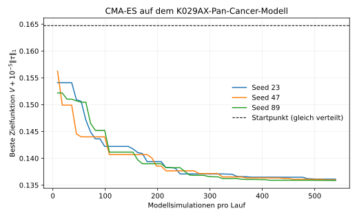

# Task 2

## Parameterschätzung dynamischer Modelle

Die Aufgabe bezieht sich auf [Fröhlich et al. (2018), DOI:
10.1016/j.cels.2018.10.013](https://doi.org/10.1016/j.cels.2018.10.013)
([lokales PDF](sources/froehlich_2018_parameter_estimation_drug_response.pdf),
[Marker-Volltext](sources/markdown/froehlich_2018_parameter_estimation_drug_response/froehlich_2018_parameter_estimation_drug_response.md))
und [Schmucker et al. (2021), DOI:
10.1371/journal.pcbi.1009689](https://doi.org/10.1371/journal.pcbi.1009689)
([lokales PDF](sources/schmucker_2021_combination_treatment_optimization.pdf),
[Marker-Volltext](sources/markdown/schmucker_2021_combination_treatment_optimization/schmucker_2021_combination_treatment_optimization.md)).
Die Literaturzahlen und die eigenen Messungen werden im Folgenden getrennt
ausgewiesen. Abschnitt 5 enthält einen neu ausgeführten CMA-ES-Benchmark auf
dem veröffentlichten Pan-Cancer-SBML-Modell. Seitenangaben bei Fröhlich
beziehen sich auf die gedruckten Zeitschriftenseiten bzw. die Methodenseiten
e1–e6, bei Schmucker auf die PDF-Seiten 1–22.

### 1. Modell und Parameterschätzung bei Fröhlich et al.

#### Was wird modelliert?

Das Modell verbindet ERBB-, RAS- und PI3K/AKT-Signalwege mit der Regulation von
Transkriptionsfaktoren wie MYC und AP1. Es enthält 1.228 molekulare Spezies in
vier Kompartimenten, 2.686 Reaktionen, 108 Gene und 36 aktivierende
Mutationsvarianten. Berücksichtigt werden Synthese, Abbau, Transport und
Proteininteraktionen sowie Haupt- und Nebenziele von sieben untersuchten
Kinaseinhibitoren. Die Struktur wurde aus Literatur und ConsensusPathDB
zusammengestellt und in SBML beschrieben (S. 568–570, Abb. 1–2).

Die Reaktionen ergeben ein ODE-System der Form

$$
\frac{dx}{dt}=S\,v(x,\theta,d,c).
$$

Hier bezeichnet $x$ die Konzentrationen, $S$ die stöchiometrische Matrix,
$\theta$ die unbekannten kinetischen Parameter, $d$ die Wirkstoffkonzentrationen
und $c$ die zelllinienspezifischen Genexpressionswerte einschließlich der
Mutationsvarianten. Die Reaktionsraten folgen dem Massenwirkungsgesetz.
Genexpression bestimmt die Syntheseraten. Die übrigen kinetischen Parameter
werden über Zelllinien hinweg gemeinsam geschätzt: Ihre Gleichheit ist eine
Modellannahme über die chemischen Eigenschaften der beteiligten Moleküle,
keine experimentell gesicherte Gleichheit aller zellulären Bedingungen
(S. 569–570; Methoden S. e2–e3).

Der beobachtbare Endpunkt ist die relative Zellviabilität gegenüber einer
unbehandelten Kontrolle. Eine phänomenologische Funktion berechnet einen
Viabilitätswert aus aktiven nukleären Transkriptionsfaktoren: zwölf positiv
wirkende Beiträge stehen im Zähler, vier negativ wirkende Beiträge im Nenner.
Auch deren Gewichte werden geschätzt. Dieser Wert wird durch den entsprechenden
Wert der unbehandelten Kontrolle geteilt. Zellteilungen und Zelltod werden
also nicht einzeln mechanistisch simuliert; der Endpunkt fasst ihre Nettowirkung
zusammen. Das ATP-basierte CellTiter-Glo-Signal dient experimentell als Proxy
für die Zahl lebensfähiger Zellen (S. 569; Methoden S. e3).

#### Welche Daten bestimmen die Parameter?

Die Autoren verwenden CCLE-Daten von 120 Krebszelllinien aus Brust, Dickdarm,
Lunge, Pankreas und Haut. Sie umfassen sieben Wirkstoffe in bis zu neun
Konzentrationen und insgesamt mehr als 6.900 experimentelle Bedingungen.
Das Training umfasst Einzelwirkstoffbehandlungen, keine Kombinationen.

Für die fünffache Kreuzvalidierung wird auf Ebene der Zelllinien getrennt:
Jeweils 96 Zelllinien bilden das Training, 24 den zurückgehaltenen Testsatz.
Damit stehen je Trainingssatz 5.390–5.403 Bedingungen zur Verfügung. Die
Trennung verhindert, dass lediglich andere Konzentrationen derselben Zelllinie
als vermeintlich unabhängiger Test dienen (S. 570; Methoden S. e1).

Mehr als 4.100 unbekannte Parameter werden durch Minimierung der quadrierten
Abweichungen geschätzt. Mit $y_{c,d}$ als simuliertem Viabilitätswert und
$V^{\mathrm{obs}}_{c,d}$ als gemessener relativer Viabilität lautet die Zielfunktion

$$
J(\theta)=\frac12\sum_{c\in C}\sum_{d\in D_c}
\left[V^{\mathrm{obs}}_{c,d}-
\frac{y_{c,d}(\theta)}{y_{c,0}(\theta)}\right]^2.
$$

Dies entspricht unter unabhängigem additivem normalverteiltem Messrauschen
gleicher Varianz einer Maximum-Likelihood-Schätzung. Das Optimierungsproblem
ist nichtlinear und nichtkonvex. Pro Kreuzvalidierung führen die Autoren zehn
lokale Optimierungen mit verschiedenen Startpunkten aus. PESTO steuert
`fmincon` mit einem Interior-Point-Verfahren; optimiert wird in logarithmischen
Parametern innerhalb $[10^{-2},10^2]$. Jeder Lauf endet nach 100 Iterationen.
Die Vorhersage ist der Median der Simulationen der fünf besten Trainingsfits.
Testdaten werden dafür weder zur Parameterschätzung noch zur Auswahl der fünf
Fits verwendet (S. 570–571; Methoden S. e4–e5).

Für jede Zelllinie wird zunächst der unbehandelte stationäre Zustand berechnet.
Die behandelten Simulationen starten dort und laufen erneut bis zum stationären
Zustand. Die Autoren nehmen an, dass die Messung nach 72 Stunden diesen Zustand
annähert. Das ist kein Beleg für korrekte zeitaufgelöste Konzentrationsverläufe
(Methoden S. e3–e4).

### 2. Woher kommt die Beschleunigung um mehr als 10.000?

Die teure Operation ist die wiederholte Berechnung des Gradienten von $J$.
Bei Vorwärtssensitivitäten werden die Änderungen aller Zustandsgrößen bezüglich
der einzelnen Parameter mitgeführt. Der zusätzliche Integrationsaufwand wächst
daher stark mit der Parameterzahl. Für dieses Modell veranschlagen die Autoren
rund $5\times10^4$ CPU-Stunden für eine einzige Gradientenberechnung mit dem
verglichenen konventionellen Ansatz (S. 570, Abb. 3A).

Drei Änderungen reduzieren diesen Aufwand:

1. Ein Sparse-Solver nutzt aus, dass nur etwa 0,5 % der Einträge der
   Jacobi-Matrix ungleich null sind. AMICI verwendet den steifen ODE-Solver
   aus SUNDIALS und den KLU-Solver für die linearen Gleichungssysteme.
2. Adjungierte Sensitivitätsanalyse berechnet die Ableitungen eines skalaren
   Outputs nach vielen Parametern, ohne für jeden Parameter ein vollständiges
   Sensitivitätssystem vorwärts zu integrieren. Dafür werden Vorwärtstrajektorie
   und adjungiertes System verwendet. Die spezielle Implementierung berechnet
   die Gradienten der behandelten und unbehandelten Viabilität getrennt und
   kombiniert sie per Quotientenregel. Die Kontrolle muss dadurch nicht für
   jeden behandelten Fall in einem verdoppelten Zustandsmodell erneut simuliert
   werden (Methoden S. e4–e5).
3. Verschiedene Zelllinien werden parallel ausgewertet. Zusätzlich laufen die
   verschiedenen lokalen Optimierungen auf verschiedenen Rechenknoten.

Der Wechsel von dichter linearer Algebra und Vorwärtssensitivitäten zu
Sparse-Solver und adjungierten Sensitivitäten ergibt zusammen eine
Beschleunigung um mehr als Faktor 37.000. Dieser gemeinsame Faktor darf nicht
jedem der beiden Bestandteile einzeln zugeschrieben werden. Acht Kerne, davon
sieben Worker, bringen bei der Gradientenberechnung einen weiteren Faktor 6,4.
Insgesamt berichtet die Arbeit mehr als Faktor 240.000 für die erwartete
verstrichene Rechenzeit. Die gerundeten Einzelangaben liefern
$37.000\times6{,}4=236.800$ und rekonstruieren den berichteten Gesamtfaktor
daher nur näherungsweise. Die 50 Optimierungsläufe für sämtliche
Kreuzvalidierungen konnten mit 400 Kernen in weniger als einer Woche
durchgeführt werden. Diese zusätzliche Parallelisierung der Optimierungsläufe
ist vom 6,4-fachen Gewinn innerhalb einer Gradientenberechnung zu unterscheiden
(S. 570, Abb. 3A; Methoden S. e4).

**Eine allgemeine 10.000-fache Beschleunigung wird nicht garantiert.**
Die Formulierung der Aufgabe ist hier zu stark. Der Faktor ist ein
modell- und implementationsabhängiges Benchmark-Ergebnis. Insbesondere wurden
die sehr langsamen Vorwärtssensitivitäten nicht für das gesamte Training
vollständig durchgerechnet: Die Autoren messen repräsentative Einzelbedingungen
und extrapolieren. Die Vergleiche von dichter und dünn besetzter linearer Algebra sowie von
Vorwärts- und adjungierten Sensitivitäten beruhen auf 100 Stichproben aus
Parametervektoren und Zelllinien, jeweils für eine unbehandelte Einzelbedingung.
Die Zeiten werden so normiert, dass der Median des Sparse-Adjoint-Verfahrens
zur separat gemessenen Gesamtauswertung passt. Für den vollständigen ersten
Trainingssatz werden zehn zufällige Parametervektoren betrachtet; sequenzielle
und parallele adjungierte Auswertungen werden gemessen, die
Vorwärtssensitivitäten hochgerechnet (Methoden S. e5).

Der methodische Vorteil erklärt, weshalb große Gewinne bei vielen Parametern,
einem skalaren Output und einer dünn besetzten Jacobi-Matrix plausibel sind.
Für kleinere oder dichter gekoppelte Modelle, andere Toleranzen und andere
Hardware muss neu gemessen werden. CPU-Zeit und parallele Laufzeit sind dabei
zu unterscheiden. Auch die Konvergenz zu einem globalen Minimum und eine
bestimmte Vorhersagegüte werden durch den Laufzeitgewinn nicht zugesichert.

### 3. Nutzen, Vorhersagen und experimentelle Evidenz

#### Einzelwirkstoffe und neue Zelllinien

Nach dem Training lässt sich eine neue Zelllinie durch Expressions- und
Mutationsdaten individualisieren. Das Modell sagt ihre dosisabhängige relative
Viabilität voraus. Die wichtigsten Prüfungen sind getrennt zu betrachten
(S. 571–573, Abb. 4–5):

| Datensatz / Prüfung | Pearson-$r$ | RMSE | Was wird geprüft? |
|---|---:|---:|---|
| CCLE-Training | $0{,}85\pm0{,}01$ | $0{,}14\pm0{,}01$ | Anpassung an bereits verwendete Daten |
| Zurückgehaltene CCLE-Zelllinien | $0{,}69\pm0{,}09$ | $0{,}19\pm0{,}03$ | Übertragung auf andere Zelllinien derselben Gewebegruppen |
| 31 zusätzliche Zelllinien aus Niere, Weichgewebe, Ovar und Magen | $0{,}62\pm0{,}03$ | $0{,}17\pm0{,}01$ | Übertragung auf im Training nicht enthaltene Gewebe |
| GDSC-Messungen für Trainingszelllinien | $0{,}51\pm0{,}01$ | $0{,}25\pm0{,}01$ | Übertragung zwischen experimentellen Datensätzen |

Die angegebenen Unsicherheiten entsprechen den berichteten
95-%-Konfidenzintervallen über die Kreuzvalidierungen; sie sind keine
individuellen Vorhersageintervalle für einzelne Patienten oder Zelllinien.
Die geringe GDSC-Übereinstimmung muss gegen die direkte Übereinstimmung zwischen
CCLE und GDSC eingeordnet werden: Diese liegt selbst nur bei
$r=0{,}49\pm0{,}01$ und RMSE $0{,}26\pm0{,}01$. Unterschiede zwischen
Assay-Protokollen begrenzen die Vergleichbarkeit.

Die Parametrisierung ist entscheidend. Ensembles zufälliger Parameter erreichen
nur etwa $r=0{,}18$ bis $0{,}22$. Ein prinzipieller Genauigkeitsvorsprung vor
statistischen Verfahren wird aber nicht gezeigt: Random Forest erreicht im
zurückgehaltenen Testsatz $r=0{,}73\pm0{,}05$, RMSE $0{,}17\pm0{,}02$;
`glmgraph` im unabhängigen Gewebetestsatz $r=0{,}70\pm0{,}01$, RMSE
$0{,}16\pm0{,}01$. Der Nutzen des mechanistischen Modells liegt zusätzlich
in der Darstellung von Eingriffen und molekularen Hypothesen.

#### Wirkstoffkombinationen

Die anspruchsvollere Prüfung nutzt Kombinationsdaten von O'Neil et al., die
nicht zum Training gehörten. Der betrachtete Überlapp umfasst zehn Zelllinien
und die drei Wirkstoffe Erlotinib, Lapatinib und PD0325901. Pro
Kreuzvalidierung werden dabei nur Zelllinien berücksichtigt, die im jeweiligen
Training enthalten waren. Getestet wird damit die Übertragung von
Einzelwirkstoffen auf Zweierkombinationen bekannter Zelllinien, nicht
zugleich auf unbekannte Kombinationen und unbekannte Zelllinien
(S. 575–576, Abb. 7).

Für Einzelwirkstoffe in diesem externen Datensatz beträgt die Korrelation
$0{,}80\pm0{,}02$ bei RMSE $0{,}16\pm0{,}01$. Für Zweierkombinationen
liegt $r$ bei $0{,}75\pm0{,}03$. Das ist höher als bei Bliss Independence
und Highest Single Agent mit jeweils $0{,}67\pm0{,}01$. Allerdings haben
diese Referenzmodelle den niedrigeren RMSE: Das mechanistische Modell
überschätzt die verbleibende Viabilität systematisch. Höhere Korrelation
bedeutet somit keine Überlegenheit nach jedem Fehlermaß.

Die Ergebnisse stützen eine Verwendung zur Priorisierung von Kombinationen für
Laborversuche. Sie belegen weder jede vorhergesagte Synergie noch die
Wirksamkeit einer Behandlung im Patienten. Auch ein hoher Korrelationswert
allein garantiert keine korrekte Rangfolge jedes einzelnen Kandidaten.

#### Identifizierbarkeit und Vorhersageunsicherheit

Ein guter Fit bestimmt nicht alle Reaktionskonstanten eindeutig. Strukturelle
Nichtidentifizierbarkeit bedeutet, dass selbst ideale Messungen bei gegebener
Modell- und Beobachtungsstruktur Parameter nicht eindeutig trennen können.
Praktische Nichtidentifizierbarkeit entsteht durch begrenzte oder verrauschte
Messungen. Bei Fröhlich zeigt die Fisher-Informationsmatrix viele numerisch
verschwindende und weit auseinanderliegende Eigenwerte. Das spricht für schwach
bestimmte Parameterrichtungen und starke "Sloppiness" (S. 573–574, Abb. 6).
Eine numerische lokale Analyse ersetzt allerdings keinen vollständigen
strukturellen Identifizierbarkeitsbeweis.

Trotzdem können Viabilitätsvorhersagen stabil sein: Verschiedene
Parameterkombinationen können denselben beobachtbaren Output erzeugen.
In der Ensembleanalyse bleibt der durch Vorhersagevarianz erklärte Anteil des
mittleren quadratischen Fehlers insgesamt unter 50 %; der größere Anteil
entfällt auf den Bias. Das beweist keine kleine Unsicherheit sämtlicher
molekularer Zustände oder künftiger Interventionen.

Die Autoren konnten für dieses große Modell weder vollständige
Profil-Likelihood-Analysen noch Posterior-Sampling durchführen. Auch geringe
Streuung zwischen Optimierungsläufen ist kein sicherer Identifizierbarkeitsbeleg:
Das Interior-Point-Verfahren bevorzugt für uninformative Parameter den Wert 1.
Solche Parameter können deshalb ähnlich aussehen, obwohl die Messdaten sie
kaum bestimmen (Methoden S. e4; S. 573).

Als molekulare Hypothesen untersuchen die Autoren unter anderem
Gleichgewichtskonstanten reversibler Reaktionen und Sensitivitäten gegenüber
Genexpression. Neun Gleichgewichtskonstanten unterscheiden sich nach ihrer
Analyse signifikant von 1; fünf zugehörige Reaktionen waren bereits als relevant
bekannt. Beispiele betreffen Rezeptordimerisierung und RAF-Interaktionen bei
BRAF-Inhibition. Diese Literaturübereinstimmung liefert Plausibilität, aber
keine neue direkte Messung der geschätzten Konstanten (S. 574–575, Abb. 6D).

### 4. Therapieoptimierung bei Schmucker et al.

#### Was ändert sich gegenüber 2018?

Fröhlich schätzt Modellparameter aus Messdaten. Schmucker hält die zuvor
bestimmten Modellparameter fest und optimiert die Wirkstoffkonzentrationen.
Die ODE-Simulation wird damit zur Bewertungsfunktion für Behandlungsvorschläge.
Die Arbeit nennt 1.228 Spezies, 2.704 Reaktionen und 4.104 Parameter,
aufgeteilt in 4.088 kinetische Parameter und 16 Outputgewichte. Die abweichende
Reaktionszahl gegenüber 2018 wird hier quellengetreu angegeben; ihre Ursache
wurde nicht durch einen Vergleich der SBML-Versionen geprüft (S. 4–5, Gl. 1).

Ein Behandlungskandidat ist ein Vektor $\tau\in\mathbb R_{\geq0}^7$ für
CHIR-265, Erlotinib, Lapatinib, PD0325901, PLX-4720, Selumetinib und
Vandetanib. Für jede Behandlung gilt

$$
\mathcal T=\left\{\tau\geq0:\sum_{j=1}^{7}\tau_j\leq8000\right\},
$$

wobei die Konzentrationen in nM eingesetzt werden. Die Grenze von 8.000 nM
orientiert sich am Konzentrationsbereich der Trainingsdaten. Sie ist keine
klinische Verträglichkeitsgrenze. Untersucht werden 12 kolorektale,
19 Melanom-, 10 Pankreas- und 20 Brustkrebszelllinien, deren Daten bereits bei
der früheren Modellkalibrierung verwendet wurden (S. 5, 8–9).

#### Zielfunktionen

Für eine einzelne Zelllinie $c$ minimiert die Suche

$$
\min_{\tau\in\mathcal T}\bigl[V_c(\tau)+\lambda R(\tau)\bigr].
$$

$V_c$ ist die relative Viabilität bzw. der relative Proliferationsscore des
Modells. $R$ bestraft die Wirkstoffbelastung, und $\lambda$ legt den Kompromiss
zwischen geringer Viabilität und niedriger Konzentration fest. Die Autoren
vergleichen $L_1$, $L_2$ und eine logarithmische Strafe:

$$
R_1(\tau)=\sum_j\tau_j,\qquad
R_2(\tau)=\sqrt{\sum_j\tau_j^2},\qquad
R_{\ln}(\tau)=\sum_j\ln(1+\tau_j).
$$

Dabei sind die numerischen Konzentrationswerte in nM gemeint. $L_1$ bestraft
die Gesamtkonzentration, $L_2$ bevorzugt bei gleicher Summe gleichmäßiger
verteilte Konzentrationen, und die logarithmische Strafe begünstigt Lösungen
mit weniger Wirkstoffen. Diese Strafen sind Ersatzgrößen für Nebenwirkungen.
Ein Wirkstoff bei 100 nM muss nicht genauso toxisch sein wie ein anderer bei
100 nM (S. 5–6, Gl. 2–3; S. 17).

Für eine Gruppe von Zelllinien desselben Gewebes wird vor allem das ungünstigste
Ansprechen minimiert:

$$
\min_{\tau\in\mathcal T}\left[\max_{c\in C}V_c(\tau)+\lambda R(\tau)\right].
$$

So soll keine schlecht ansprechende Zelllinie hinter einem guten Mittelwert
verschwinden. Zelllinien desselben Gewebes dienen dabei als Proxy für
unterschiedliche Tumorklone. Alternativ wird die durchschnittliche Viabilität
minimiert (S. 6, Gl. 4).

Bei $n$ Behandlungsschritten lautet das Hauptziel

$$
\min_{(\tau^1,\ldots,\tau^n)\in\mathcal T^n}
\left[\max_{c\in C}\prod_{i=1}^{n}V_c(\tau^i)
+\lambda\sum_{i=1}^{n}R(\tau^i)\right].
$$

Die Multiplikation setzt eine entsprechende Fortpflanzung relativer
Zellzahlen voraus, etwa bei exponentiellem Wachstum mit
behandlungsabhängigen Wachstumsraten. Jeder Schritt wird als 72-Stunden-Intervall
interpretiert. Das beschreibt die Selektion unterschiedlich empfindlicher
Zelllinien; eine realistische Pharmakokinetik zwischen Einnahmezeitpunkten
wird damit nicht berechnet (S. 6–7, Gl. 5–8).

#### Warum CMA-ES mit Hamiltonian Monte Carlo?

CMA-ES sucht ohne Gradienten. Es zieht Behandlungskandidaten aus einer
mehrdimensionalen Normalverteilung, bewertet sie durch ODE-Simulationen und
passt Mittelwert und Kovarianz anhand der besten Kandidaten an. So werden
auch Abhängigkeiten zwischen günstigen Wirkstoffkonzentrationen gelernt.
Eine Garantie auf das globale Optimum besteht wegen der nichtkonvexen
Zielfunktion nicht (S. 7–8).

Die Nebenbedingungen machen gewöhnliches Ziehen mit anschließendem Verwerfen
unzulässiger Kandidaten ineffizient. Bei zwei Schritten gibt es 14 Variablen,
bei drei Schritten 21. Die Autoren ersetzen das Rejection-Sampling durch ein
Hamiltonian-Monte-Carlo-Verfahren für abgeschnittene multivariate
Normalverteilungen. HMC erzeugt hier zulässige Kandidaten für CMA-ES; es dient
nicht zur Schätzung einer posterioren Unsicherheit der biologischen Parameter.

Der berichtete Aufwand pro Iteration für die Kandidatenerzeugung sinkt bei
zwei Schritten von bis zu fünf Minuten auf unter drei Sekunden. Bei drei
Schritten konnte Rejection-Sampling innerhalb von acht Stunden keine Iteration
abschließen; HMC benötigt unter acht Sekunden. Auch das sind konkrete
Laufzeitbeobachtungen, keine universellen Faktoren. Die Bewertung eines
Kandidaten für eine Zelllinie dauert etwa eine Sekunde und dominiert danach
die Optimierung. Kandidaten und Zelllinien werden parallel ausgewertet
(S. 8–9).

### 5. Eigener Reproduktionsbenchmark

#### Originalcode und notwendige Portierung

Der Benchmark verwendet zwei von den Autoren benannte Repositorien. Das
[Referenzmodell](https://github.com/FFroehlich/reference_simulator) wurde auf
Commit `6916101b6df55ca97f5522a999c0dc499d6e4362` fixiert, der
[Therapieoptimierer](https://github.com/Sandholm-Lab/treatment-opt-pancancer)
auf Commit `62b25f5d4956e91c509d561c999c4cceb98a1081`. SHA-256-Prüfsummen sichern
beide Quellarchive ab. Der Zenodo-Datensatz von Fröhlich et al.
([DOI 10.5281/zenodo.1472794](https://doi.org/10.5281/zenodo.1472794)) wurde
ebenfalls geprüft; sein Archiv hat die in Zenodo angegebene MD5-Prüfsumme
`48281e602881025b5be2c2beb0faded0`.

Die historische Umgebung von Schmucker lässt sich auf dem verwendeten
Apple-Silicon-Rechner nicht unverändert installieren. Sie fixiert unter anderem
`amici==0.10.13`, `petab==0.0.0a16`, `numpy==1.22.0` und
`pandas==0.25.3`. Ein isolierter Installationsversuch mit Python 3.12 bricht
bereits beim Bau von AMICI 0.10.13 ab. Deshalb wurde nur die Schnittstelle auf
AMICI 1.1.0 portiert. SBML-Datei, Parametersatz, K029AX-Expressionsprofil,
Wirkstoffe und Zielfunktion blieben unverändert. Die Umgebung ist über
[`pyproject.toml`](pyproject.toml) und [`uv.lock`](uv.lock) fixiert.

Der frische Modellbau dauerte auf einem Apple M4 Pro 66,84 s. Das eingelesene
SBML-Modell hat 1.228 Zustände und 2.686 Reaktionen. AMICI erzeugt daraus 4.234
freie und 638 feste Parameter sowie den Output `observable_proliferation`.
Die 2.686 Reaktionen stimmen mit Fröhlich et al. überein. Die von Schmucker
genannten 2.704 Reaktionen lassen sich mit dem von ihrem Repository verlinkten
Referenzmodell nicht rekonstruieren; dafür wäre eine andere, dort nicht
versionierte Modellfassung nötig.

#### Benchmarkdesign

Getestet wurde die Einzelzelllinien-Optimierung aus Gleichung 3 für die
Melanomzelllinie K029AX. Die sieben Konzentrationen liegen auf dem Simplex
$\sum_j\tau_j\leq 8000$ nM. Als Zielfunktion dient

$$
J(\tau)=V_{\mathrm{K029AX}}(\tau)+10^{-5}\sum_j\tau_j.
$$

Die CMA-ES-Hyperparameter folgen dem veröffentlichten Code: neun Kandidaten,
vier Eliten, Startvarianz $\sigma=0{,}25$ und ein gleich verteilter Startpunkt.
Je Seed liefen 60 statt der publizierten 400 Iterationen. Die Seeds 23, 47 und
89 ergeben 1.620 Kandidatensimulationen; Nullkontrolle und Startpunkt erhöhen
die Gesamtzahl auf 1.622. Jede Simulation integriert das vollständige Modell
bis zum stationären Zustand. Relative und absolute Toleranz sind auf
$10^{-8}$ gesetzt.

| Lauf | bestes $J$ | relative Proliferation $V$ | Gesamtdosis [nM] |
|---:|---:|---:|---:|
| Startpunkt, gleich verteilt | 0,164721 | 0,084721 | 8.000,00 |
| Seed 23 | 0,136114 | 0,090965 | 4.514,93 |
| Seed 47 | 0,135990 | 0,088724 | 4.726,54 |
| Seed 89 | **0,135859** | 0,090638 | 4.522,15 |

Der beste Lauf senkt die Zielfunktion gegenüber dem Startpunkt um 17,5 % und
die Gesamtdosis um 43,5 %. Die relative Proliferation steigt dabei von 0,0847
auf 0,0906. Das ist der erwartete Kompromiss der $L_1$-Strafe, kein biologischer
Wirksamkeitsgewinn bei gleicher Dosis. Der beste Cocktail enthält vor allem
Lapatinib (1.672,38 nM), PD0325901 (1.456,69 nM) und Erlotinib
(1.087,87 nM); weitere 292,50 nM entfallen auf PLX-4720. Die übrigen drei
Wirkstoffe liegen zusammen unter 13 nM.

{fig-alt="Drei fallende Konvergenzkurven der Seeds 23, 47 und 89 über 540 Modellsimulationen je Lauf." width=85%}

Die 1.622 Simulationen benötigten 114,81 s reine Modellzeit und 116,36 s
Gesamtlaufzeit. Eine Simulation dauerte im Mittel 0,0708 s. Dieser Wert gehört
zur eigenen M4-Pro-Messung mit AMICI 1.1.0. Er darf weder mit der etwa
einsekündigen Cluster-Messung von Schmucker noch mit den
Sensitivitätsbenchmarks von Fröhlich gleichgesetzt werden.

Der Benchmark prüft, ob der veröffentlichte Mechanismus mit dem angegebenen
CMA-ES-Verfahren heute ausführbar ist und ob die Zielfunktion konvergiert. Er
ist keine Wiederholung der gesamten Simulationsstudie: Es fehlen 400
Iterationen, das vollständige $\lambda$-Raster, die beiden Baselines und die
weiteren Zelllinien. Eine Vorhersagekennzahl gegen unabhängige Messdaten wird
nicht berechnet, weil dieser Optimierungslauf keine beobachteten
Kombinationsdaten enthält. Die Rohdaten, Skripte und das Protokoll liegen im
[`benchmark`-Verzeichnis](benchmark/README.md).

### 6. Ergebnisse und Grenzen der Therapieoptimierung

Die Autoren vergleichen ihre Kandidaten mit dem jeweils besten Einzelwirkstoff
und mit optimierten Zweierkombinationen aus PLX-4720 und PD0325901.
Letztere dienen als Modell-Proxy für die klinische Kombination aus
Vemurafenib und Cobimetinib. Ein direkter klinischer Vergleich mit diesen
Medikamenten findet nicht statt. Einzelkonzentrationen werden für die
Referenzsuche in 1-nM-Schritten, Mischungsverhältnisse der Zweierkombination
in 5-%-Schritten geprüft (S. 9).

Die Simulationsstudie zeigt folgende Ergebnisse:

1. Für die Melanomzelllinie K029AX mit BRAF-V600E findet die Suche
   Kombinationen mit geringerer vorhergesagter Viabilität bei geringerer
   Gesamtkonzentration als die beiden Referenzen. Der Vorteil hängt von der
   Zelllinie ab: Für A2058 werden deutliche Vorteile oberhalb von 500 nM
   berichtet, für MDAMB435S nur geringe Verbesserungen gegenüber der
   RAF/MEK-Zweierkombination (S. 9–11, Abb. 2 und Beschreibung von S1 Appendix).
2. Für Gruppen von Zelllinien aller vier Gewebe ergeben sich bei mittleren und
   hohen Konzentrationen niedrigere maximale Viabilitätswerte als bei den
   Referenzen. Für Pankreaszelllinien wird eine Reduktion gegenüber den
   Referenzen um bis zu Faktor drei bei niedrigen Strafgewichten
   ($\lambda<10^{-4{,}5}$) und maximaler Gesamtkonzentration von 8.000 nM
   berichtet. Das ist ein Modellvergleich, keine gemessene Tumorverkleinerung
   (S. 11–12, Abb. 3 und Beschreibung von S2 Appendix).
3. Zeitlich wechselnde Zweischrittpläne bringen meistens nur geringe
   zusätzliche Verbesserungen. Ein Beispiel für kolorektale Zelllinien bei
   derselben über beide Schritte summierten Konzentration von 550 nM erreicht
   einen maximalen relativen Proliferationsscore von 0,6048 gegenüber 0,6978
   bei Wiederholung desselben Cocktails. Das entspricht rund 13 % niedrigerem
   Score. Zunächst werden PD0325901, PLX-4720 und Erlotinib eingesetzt,
   anschließend niedriger dosiert PD0325901, Lapatinib und Erlotinib
   (S. 12, Abb. 4).
4. Die Zielwahl verändert das Ergebnis. Beispielsweise ergibt die
   Worst-Case-Optimierung für Brustkrebszelllinien eine mittlere Viabilität
   von etwa 0,2010; direkte Mittelwertoptimierung erreicht etwa 0,1589
   ($L_1$, $\lambda=10^{-7}$). Der bessere Mittelwert beantwortet eine
   andere Frage als der Schutz vor der am schlechtesten ansprechenden
   Zelllinie (S. 13).

Die Optimierung ist nicht eindeutig. Zusätzliche Läufe zeigen wechselnde
Cocktails, etwa weil PLX-4720 und CHIR-265 mit ähnlicher Affinität RAF
adressieren. Vor allem die logarithmische Strafe führt zu hoher Streuung und
lokalen Optima. Wiederholte Optimierungen prüfen damit die algorithmische
Stabilität, nicht die biologische Richtigkeit der Vorhersagen
(S. 13–15, Abb. 5–6).

Die wichtigste Einschränkung ist die fehlende experimentelle Prüfung der neu
optimierten Therapien. Schmucker übernimmt ein Modell mit validierten
Einzelwirkstoff- und Zweierkombinationsvorhersagen. Daraus folgt noch keine
Validierung von Drei- oder Vierfachkombinationen oder sequenziellen Plänen.
Die Suche könnte gerade solche Konzentrationsbereiche bevorzugen, in denen
der Modellfehler günstig erscheint. Neue Laborversuche sind deshalb nötig
(S. 16–17).

Auch eine geringere Konzentrationsstrafe belegt keine geringere Toxizität.
Die Autoren beobachten häufig hohe Anteile von PD0325901 und weisen auf
bekannte On-Target-Toxizitäten dieses MEK-Inhibitors hin. Wirkstoffspezifische
Toxizität, Wechselwirkungen und Pharmakokinetik fehlen in der einfachen
Regularisierung (S. 16–17).

Schließlich nimmt das Modell statische zelllinienspezifische Transkription an.
Adaptive Resistenz durch transkriptionelle Rückkopplungen wird dadurch nur
unzureichend erfasst. Zwischen stationären Behandlungen besteht im Modell
kein zelluläres Gedächtnis; die Population verändert sich durch die
unterschiedliche Vermehrung der Zelllinien. In der Produktformel bleibt das
Endergebnis bei Vertauschung der Schritte gleich. Diese eigene Folgerung aus
Gl. 5 begrenzt die Interpretation als Optimierung einer biologisch wirksamen
Reihenfolge: Optimiert werden wechselnde Cocktails und ihre gemeinsamen
Effekte, nicht alle zeitabhängigen Anpassungsmechanismen realer Tumoren.
Die Autoren diskutieren diese Grenze des stationären Ansatzes ausdrücklich
(S. 16–17).
