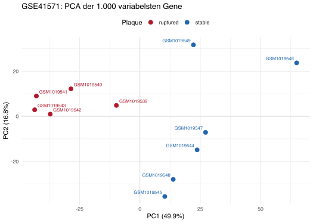
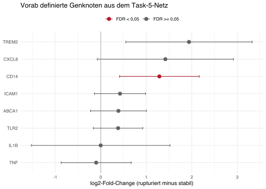

## Ergebnis und Geltungsbereich

Für die Interpretation humaner Atherosklerosedaten wurde ein **statisches Evidenznetz mit 22 Knoten und 18 Kanten** erstellt. Es verbindet Cholesterinefflux und miRNA-Regulation mit beobachteten Makrophagenzuständen, Blutmonozyten-Phänotypen sowie der Kommunikation zwischen Neutrophilen und anderen Gefäßzellen. Jede Kante besitzt einen Relationstyp, einen Zellkontext, eine Primärquelle und eine Grenze ihrer Aussagekraft. Die maschinenlesbaren Dateien sind [network.json](data/network.json), [nodes.tsv](data/nodes.tsv) und [edges.tsv](data/edges.tsv).

Das Netz ist eine begrenzte, LLM-unterstützte Kuration. Es ist weder ein vollständiges menschliches Stoffwechselmodell noch ein aus Patientendaten geschätztes Wirkungsmodell. Proprietäre SFB1123-Daten lagen nicht vor. Die öffentliche humane GEO-Serie `GSE41571` wurde deshalb als eigenständiger quantitativer Test verwendet: fünf rupturierte und sechs stabile Karotisplaques, jeweils eine Patientenprobe. Nach dem dokumentierten Present/Absent-Filter wurden 12.113 Gene mit einem moderierten linearen Modell verglichen. Der ältere multimodale Bashore-Datensatz bleibt als technischer Audit einer moderneren Einzelzellressource enthalten.

Vier Studien tragen die biologische Argumentation: Rayner et al. zur miR-33-Regulation, Quillard et al. zur Endothel-Neutrophilen-Interaktion, Warnatsch et al. zum NET-Priming und Bashore et al. als Datenbeispiel. Depuydt et al. und Wong et al. ergänzen die Zellzustands- und Markerannotation. Die Einschränkung auf diese Module macht jede Netzwerkaussage überprüfbar; große Teile der Plaquebiologie, etwa Efferocytose und Matrixumbau, bleiben außerhalb des Exports.

## 1. Welche Zellen und welche Erkrankung werden abgebildet?

Atherosklerotische Plaques sind heterogene Gewebe. Makrophagenbefunde lassen sich deshalb nicht als einheitliche Aktivierung eines einzigen Zelltyps lesen. Depuydt et al. beschrieben in menschlichen Karotisplaques entzündliche Makrophagenpopulationen mit IL1B- beziehungsweise TNF-Expression sowie einen TREM2-exprimierenden, schaumzellähnlichen Zustand. Im Netz sind das Beobachtungskanten `marker_of`. Sie behaupten weder, dass das jeweilige Gen den Zustand verursacht, noch, dass alle markierten Zellen dieselbe Herkunft haben. Die verbreitete Zweiteilung in M1 und M2 bildet diese gemessene Vielfalt nur unzureichend ab. [Depuydt et al., 2020](https://doi.org/10.1161/CIRCRESAHA.120.316770)

Blutmonozyten werden hier nach den drei experimentell charakterisierten CD14/CD16-Phänotypen unterschieden: klassisch `CD14++ CD16-`, intermediär `CD14++ CD16+` und nichtklassisch `CD14+ CD16++`. Das sind relative Oberflächenmarker innerhalb eines definierten Mess- und Gatingverfahrens. Eine intermediäre Population ist keine Mischung, die man ohne Prüfung aus zwei anderen Populationen errechnen darf. Der CD16-Knoten verweist in diesem monozytären Kontext auf `FCGR3A`; er darf bei Neutrophilen nicht pauschal anstelle von `FCGR3B` verwendet werden. [Wong et al., 2011](https://doi.org/10.1182/blood-2010-12-326355)

Neutrophile werden als eigene Zellklasse behandelt. Quillard et al. untersuchten humane Endothelzellen und Neutrophile in vitro und ergänzten dies durch Plaquehistologie. TLR2-Stimulation erhöhte endotheliale Aktivierungs- und Apoptoseendpunkte; Neutrophile verstärkten die Schädigung. Daraus entsteht eine bedingte Zell-Zell-Relation, keine direkte Bindungskante zwischen einem Neutrophil und einem einzelnen Gen. [Quillard et al., 2015](https://doi.org/10.1093/eurheartj/ehv044)

Karotisatherosklerose und koronare Herzkrankheit teilen einen Krankheitskontext, aber das Gefäßbett gehört zur Probenidentität. Ein Symptomvergleich in operativ entfernten Karotisplaques ist kein direkter Test auf koronaren Infarkt und keine gesunde Kontrollgruppe. Blut, kultivierte Zellen und Plaquegewebe werden im Modell getrennt annotiert.

## 2. miRNAs und zwei überprüfbare mechanistische Module

Die Formulierung "post-translational regulators" im Aufgabenblatt ist für den üblichen miRNA-Mechanismus zu korrigieren: miRNAs wirken **posttranskriptionell** auf Ziel-RNAs, unter anderem durch verminderte Translation oder RNA-Stabilität. Eine Proteinabnahme kann daher ohne gleich große RNA-Abnahme auftreten. Eine miRNA-Zielbeziehung braucht außerdem die Identität des reifen Arms, die Spezies und den untersuchten Kontext. Experimentdatenbanken sammeln unterschiedliche Evidenzarten; ein Bindungsbefund allein belegt noch keinen physiologisch relevanten Effekt auf das Protein. [miRTarBase 2025](https://pmc.ncbi.nlm.nih.gov/articles/PMC11701613/)

### 2.1 miR-33a und Cholesterinefflux

Rayner et al. zeigten eine miR-33-abhängige Repression von ABCA1 und eine Abnahme des Cholesterineffluxes zu ApoA1; humane THP-1-abgeleitete Makrophagen liefern dabei einen menschlichen Zelllinienkontext. Die ältere Bezeichnung miR-33 wird im Export auf die reife humane `hsa-miR-33a-5p`, `MIMAT0000091`, normalisiert. Der humane Zielanker ist `NCBIGene:19` für ABCA1. Die berichtete ABCG1-Regulation ist dagegen artspezifisch: Die entsprechende Mausbeobachtung begründet keine humane miR-33a→ABCG1-Kante. [Rayner et al., 2010](https://doi.org/10.1126/science.1189862), [miRBase](https://www.mirbase.org/mature/MIMAT0000091)

H01 speichert die Zielrepression, H02 den Effluxphänotyp. H03 hält die Beteiligung von ABCA1 am Efflux fest, ohne eine zusätzliche quantitative Wirkung aus demselben Experiment vorzutäuschen. Keine dieser Kanten liefert eine Rate, eine patientenspezifische Effektstärke oder den Nachweis, dass miR-33 in einer konkreten Plaquezelle aktiv ist.

### 2.2 Neutrophile, NETs und IL-1β

Warnatsch et al. untersuchten mehrere Spezies innerhalb derselben Arbeit. Für das humane Netz werden ausschließlich die passenden Experimente verwendet: Cholesterinkristalle induzierten NET-Bildung in humanen Blutneutrophilen (Fig. 1A/B). NETs erhöhten in CD14-purifizierten humanen Blutmonozyten IL1B-Transkripte; starke Freisetzung reifen IL-1β benötigte im untersuchten System NET-Priming und nachfolgende Kristallstimulation (Fig. 3E-G). [Warnatsch et al., 2015](https://doi.org/10.1126/science.aaa8064)

Deshalb trennt H17 den RNA-Endpunkt von H18, der bedingten Freisetzung reifen Proteins. Das `condition`-Feld von H18 ist Teil der Aussage. Es darf bei einem Graphenimport nicht entfernt werden. Aus diesem Befund folgt auch keine generische NET→TLR9-Kante. Der nachgeschaltete Rezeptor lässt sich aus einer unspezifischen Hemmung nicht eindeutig zuordnen.

## 3. Ressourcen und ihre Verwendung

| Ressource | Konkreter Nutzen | Status in dieser Arbeit |
|---|---|---|
| [NCBI Gene](https://www.ncbi.nlm.nih.gov/gene/) | Stabile Genanker, offizielles Symbol, Taxonomie | Neun Gene per ESummary abgefragt; Antwort lokal gespeichert und gegen Taxon 9606 geprüft |
| [miRBase](https://www.mirbase.org/mature/MIMAT0000091) | Reife miRNA getrennt von Hairpin und Genlocus identifizieren | MIMAT0000091 gegen die gespeicherte Eintragsseite geprüft |
| [miRTarBase 2025](https://pmc.ncbi.nlm.nih.gov/articles/PMC11701613/) | Experimentell untersuchte miRNA-Ziele mit Methoden und Quellen finden | Ressource bewertet; kein ungeprüfter Gesamtexport übernommen |
| [TargetScan 8.0](https://www.targetscan.org/vert_80/docs/help.html) | Sequenzbasierte Zielhypothesen und UTR-Kontext | Vorhersagequelle, keine exportierte Evidenzkante |
| [Reactome R-HSA-181438](https://reactome.org/content/detail/R-HSA-181438) | Humaner TLR2-Signalweg als Erweiterungsrahmen; BioPAX/SBML-Ausgabe | Pathway-ID und Spezies geprüft; kein vollständiger Reaktionsexport importiert |
| [GEO GSE253904](https://www.ncbi.nlm.nih.gov/geo/query/acc.cgi?acc=GSE253904) | Öffentliche RNA-/ADT-Daten samt Probenmetadaten | Drei Serien, zwei Proben und eine Merkmalsdatei lokal dokumentiert |
| [GEO GSE41571](https://www.ncbi.nlm.nih.gov/geo/query/acc.cgi?acc=GSE41571) | Humane laser-mikrodissezierte Makrophagen-reiche Bereiche aus stabilen und rupturierten Karotisplaques | 11 unabhängige Patientenproben quantitativ reanalysiert |
| [Expression Atlas E-GEOD-8286](https://www.ebi.ac.uk/gxa/experiments/E-GEOD-8286) | Vergleichskontext humane Monozyten-Makrophagen-Differenzierung | Ergänzende Ressource; kein Plaquedatensatz und hier nicht numerisch ausgewertet |

Für eine Erweiterung sollten Interaktionen aus Datenbanken zunächst in eine Kandidatentabelle importiert werden. Das notwendige Schema entspricht dem Export: Quelle, Ziel, Relation, Taxon, Zell- und Gewebekontext, experimenteller Endpunkt und Primärquelle. Erst danach werden Synonyme normalisiert und Mehrfachbelege derselben Aussage zusammengeführt. Für Stoffwechselreaktionen wären zusätzlich Substrate, Produkte, Stöchiometrie und Kompartimente nötig. Eine Liste von Proteinpaaren liefert diese Informationen nicht.

## 4. Öffentliche Daten: was tatsächlich geprüft wurde

Bashore et al. veröffentlichten ein multimodales menschliches Karotisplaquemodell mit scRNA-seq und CITE-seq. Die Publikation beschreibt insgesamt 21 Läsionen, davon 13 symptomatisch, und 25 Zellpopulationen. Neutrophile sind ausdrücklich vertreten. Die Studie zeigt auch schaumzellartige Zustände glatter Muskelzellen; ein Schaumzellmarker reicht deshalb als Makrophagen-Herkunftsnachweis nicht aus. [Bashore et al., 2024](https://doi.org/10.1161/ATVBAHA.123.320524)

### 4.1 Akzessionen und Replikationseinheiten

Die direkten GEO-SOFT-Abrufe vom 23.09.2026 sind unter `data/` archiviert. Sie ergeben:

| Zugang | Metadatenbefund | Konsequenz |
|---|---|---|
| `GSE253904` | SuperSeries mit zwei SubSeries | Keine dritte unabhängige Kohorte |
| `GSE253902` | CITE-seq, 6 Personen, davon 5 symptomatisch; 12 GSM-Einträge | GEX und ADT dürfen nicht als unabhängige Patienten gezählt werden |
| `GSE253903` | scRNA-seq, 12 Personen, davon 6 symptomatisch; 12 GSM-Einträge | Personenstruktur separat auswerten |
| `GSM8029950` | `carotid_5, GEX`, humane Karotis, mRNA | Zugehörige Merkmals- und Matrixdateien aufgelistet |
| `GSM8029951` | `carotid_5, ADT`, prozessierte Daten beim GEX-Eintrag | Derselbe Probenkontext mit anderer Modalität |

Quellen: [CITE-seq-Serie](https://www.ncbi.nlm.nih.gov/geo/query/acc.cgi?acc=GSE253902), [scRNA-seq-Serie](https://www.ncbi.nlm.nih.gov/geo/query/acc.cgi?acc=GSE253903), [GEX-Probe](https://www.ncbi.nlm.nih.gov/geo/query/acc.cgi?acc=GSM8029950), [ADT-Probe](https://www.ncbi.nlm.nih.gov/geo/query/acc.cgi?acc=GSM8029951).

Die beiden Serienbeschreibungen nennen zusammen 18 Personen, während die Publikation insgesamt 21 Läsionen angibt. Diese Zahlen werden hier bewusst nicht durch eine angenommene Zuordnung angeglichen. Die Metadaten allein belegen weder, welche zusätzlichen Proben in die publizierte Gesamtzahl eingehen, noch vollständige Unabhängigkeit aller Studienteile. Eine Expressionsanalyse müsste die Probenzuordnung aus den vollständigen Studienmetadaten rekonstruieren. Für den hier geprüften CITE-seq-Arm bleibt die explizite Zahl von sechs Personen maßgeblich.

### 4.2 Eigene Merkmalsprüfung

Die komprimierte Datei `GSM8029950_RPE008_features.tsv.dup_marked.tsv.gz` wurde tatsächlich heruntergeladen (297.211 Byte). Sie enthält **36.884 Merkmalszeilen**, davon 36.601 `Gene Expression` und 283 `Antibody Capture`. Das Skript findet für alle neun Genknoten genau eine Genexpressionsannotation; Ensembl-Feature-IDs und die Trefferzahlen stehen in [feature_mapping.tsv](data/feature_mapping.tsv).

Das ist eine technische Zuordnungsprüfung. Die Existenz eines Gens in der Featureliste belegt weder Expression in einem Zelltyp noch einen Unterschied zwischen Patientengruppen. Der reife miRNA-Arm ist mit dieser üblichen poly(A)-RNA-/ADT-Messung nicht direkt quantifiziert. Für eine gemeinsame miRNA-mRNA-Analyse wären passende Small-RNA-Daten und eine geklärte Probenpaarung nötig. Die große Countmatrix und Sequenzrohdaten wurden nicht heruntergeladen.

### 4.3 Quantitative Reanalyse von GSE41571

Für die eigentliche Expressionsanalyse wurde [GSE41571](https://www.ncbi.nlm.nih.gov/geo/query/acc.cgi?acc=GSE41571) gewählt. Lee et al. isolierten Makrophagen-reiche Bereiche per Laser-Mikrodissektion aus menschlichen Karotisendarteriektomieproben. Die GEO-Metadaten weisen fünf rupturierte und sechs stabile Plaques aus. Jede der elf Arrays stammt aus einer eigenen Patientenprobe; Zellzahlen oder technische Messkanäle wurden nicht als Replikate gezählt. Der Vergleich ist ein Histologie- und Symptomgruppenvergleich innerhalb erkrankter Plaques. Es gibt keine gesunde Kontrollgruppe. Eine stabile Probe stammt von einer Person mit einem 365 Tage zurückliegenden lakunären Ereignis, während die übrigen stabilen Proben als asymptomatisch beschrieben sind. Die extrahierten Metadaten stehen in [samples.tsv](results/GSE41571/samples.tsv). [Lee et al., 2013](https://doi.org/10.1016/j.atherosclerosis.2012.09.037)

Die archivierte Serie enthält 54.675 Affymetrix-Probesets. Wie im GEO-Verarbeitungstext beschrieben, wurden Probesets entfernt, die in mehr als sechs der elf Arrays als `A` (absent) markiert waren; externe `AFFX`-Kontrollen wurden ebenfalls entfernt. Das reproduziert exakt **25.538 Probesets**. Eindeutig einem Gensymbol zugeordnete Probesets wurden anschließend auf der log2-Skala pro Gen gemittelt. Damit blieben **12.113 getestete Gene**. Das Modell vergleicht `rupturiert - stabil` mit `limma`, empirischer Bayes-Moderation, Intensitätstrend und robuster Varianzschätzung. Alter, Geschlecht und Stenosegrad wurden bei nur elf Proben nicht zusätzlich in das Modell gezwungen.

{width=80%}

PC1 erklärt **49,95 %**, PC2 **16,77 %** der Varianz. Die vollständige Trennung entlang PC1 ist eine Beschreibung dieser elf Proben, kein Schätzer für eine externe Klassifikationsleistung.

{width=85%}

Bei FDR < 0,05 sind **852 Gene** verändert, 305 mit höherem und 547 mit niedrigerem Signal in rupturierten Plaques. Bei FDR < 0,10 sind es 1.704 Gene. Lee et al. berichteten 914 Gene bei FDR 10 %. Die Zahl wird hier nicht als exakte Reproduktion ausgegeben: Die Publikation nutzte GeneSpring/ANOVA, während diese Reanalyse unzweideutige Probesets vor dem Test genweise mittelt und `limma` verwendet. Zwei zentrale Befunde stimmen in Richtung und Signifikanz überein: `FABP4` liegt bei log2FC 4,810 (FDR 0,0135), `LEP` bei log2FC 2,724 (FDR 0,0163). Die vollständige Tabelle steht in [de_genes.tsv](results/GSE41571/de_genes.tsv).

### 4.4 Das Evidenznetz als vorab festgelegte Genmenge

{width=82%}

Acht der neun Genknoten sind auf GPL570 eindeutig messbar. Der kompetitive `camera`-Test prüft diese vorab festgelegte Menge gegen alle übrigen getesteten Gene. Die acht Knoten sind gemeinsam in Richtung rupturierte Plaque verschoben (`P = 0,0119`). Das ist ein Genmengensignal und beweist keine der gerichteten Kanten. Auf Einzelgenebene erreicht `CD14` FDR 0,0434 und log2FC 1,288. `TREM2` hat log2FC 1,939, bleibt nach Korrektur über alle 12.113 Gene aber bei FDR 0,0692. `CXCL8` liegt bei log2FC 1,420 und FDR 0,143. `IL1B` und `TNF` zeigen in diesem Kontrast keinen Unterschied. Bei `ABCA1`, `TREM2`, `CD14`, `TLR2`, `CXCL8` und `ICAM1` bleibt die Richtung in allen elf Leave-one-patient-out-Läufen erhalten. `TNF` wechselt in zwei Läufen, das fast exakt bei null liegende `IL1B` in sechs.

`FCGR3A` kann nicht sauber ausgewertet werden. Das einzige zurückgehaltene Probeset `204006_s_at` ist in der eingefrorenen GPL570-Annotation gleichzeitig `FCGR3A` und `FCGR3B` zugeordnet. Sein Signal darf daher nicht als spezifischer Monozytenmarker ausgegeben werden. Die reife `hsa-miR-33a-5p` wird von diesem mRNA-Array ebenfalls nicht gemessen. [network_measurement_coverage.tsv](results/GSE41571/network_measurement_coverage.tsv) hält beide Grenzen maschinenlesbar fest; [network_gene_overlay.tsv](results/GSE41571/network_gene_overlay.tsv) enthält Effekte, FDR, Intervalle und Leave-one-out-Ergebnisse.

## 5. Das exportierte Evidenznetz

{width=100%}

Alle Knoten tragen Taxon 9606. `NCBIGene:` bezeichnet einen Genanker; das Feld `measured_endpoint` präzisiert, ob RNA, Protein oder ein Phänotyp gemeint ist. `miRBase:` bezeichnet die reife miRNA. `TASK5:` ist ein stabiler lokaler Namensraum für definierte Zustände und Prozesse, kein vorgetäuschter Datenbank-Identifier. Ein Genanker unterscheidet keine Isoformen oder posttranslationale Modifikationen.

| Kanten | Beziehung | Evidenzklasse und Kontext |
|---|---|---|
| H01 | miR-33a-5p hemmt ABCA1 | E1: Ziel- und Perturbationsevidenz; humane Zelllinie |
| H02-H03 | miR-33a vermindert Efflux; ABCA1 ist daran beteiligt | E2: funktioneller Endpunkt; E4: mechanistische Einordnung |
| H04-H06 | IL1B, TNF, TREM2 markieren Makrophagenzustände | E3: humane Plaque-Transkriptomik; keine Kausalrichtung |
| H07-H11 | CD14/FCGR3A kennzeichnen Monozyten-Phänotypen | E3: humane Blutmonozyten; relatives Markerniveau |
| H12-H14 | TLR2-Stimulation erhöht CXCL8, ICAM1 und Apoptose | E2: humane Endothelzellkultur; keine direkte Transkriptionskante |
| H15 | Neutrophile verstärken Endothel-Apoptose | E2: Kokultur, TLR2-aktiviertes Endothel |
| H16 | Cholesterinkristalle induzieren NET-Bildung | E2: humane Blutneutrophile |
| H17-H18 | NETs erhöhen IL1B-RNA; mit Kristall-Co-Stimulus Freisetzung reifen IL-1β | E2: humane CD14-purifizierte Blutmonozyten; bedingter Effekt |

E1 bis E4 unterscheiden Methoden und Aussageformen, keine universelle numerische Rangordnung. Neun Kanten tragen ein experimentell begründetes Vorzeichen; neun bleiben `unknown`. `unknown` bedeutet keine festgelegte Wirkung, nicht den Wert null. In der Zeichnung sind die beobachteten Module teilweise unverbunden. Sie werden nicht durch spekulative Kanten verbunden, nur um einen einzigen zusammenhängenden Graphen zu erhalten.

Für ein kausales Overlay dürfen Markerrelationen nicht als Signalfluss gezählt werden. H18 benötigt eine UND-Bedingung; ein einfacher binärer Adjazenzmatrixexport würde diese Information verlieren. Der JSON-/TSV-Export erhält sie als Attribut. Für eine ausführbare Logik wäre sie als eigene Transition mit beiden Eingängen zu modellieren.

## 6. Interpretation verschiedener Messverfahren

| Datentyp aus Aufgabe 5 | Sinnvolle Verwendung des Netzes | Zentrale Trennung |
|---|---|---|
| Bulk-RNA | Genknoten annotieren; Zellanteile und innerhalb eines Zelltyps veränderte Expression gemeinsam prüfen | Ein stärkeres Makrophagensignal kann mehr Makrophagen oder andere Zustände bedeuten |
| Sortierte Zellen | Zellkontext einschränken und innerhalb vergleichbarer Sortierdefinitionen testen | Reinheit, Aktivierung durch Verarbeitung und Ausschlussmarker dokumentieren |
| scRNA-seq | Zellzustände annotieren; pro Person und Zelltyp pseudobulk aggregieren | Zellen sind keine unabhängigen Patientenreplikate |
| CITE-seq | RNA und gemessene Oberflächenproteine derselben Barcodes vergleichen | ADT ist eine gezielte Antikörpermessung, kein ungerichtetes MS-Proteom |
| miRNA/Small-RNA | Reife Arme zuordnen, Zielmodule mit RNA-/Proteinbefunden abgleichen | Antikorrelation begründet allein keine direkte Regulation |
| Massenspektrometrie | Proteinabundanz an Genanker anbinden; Protein-Gruppenambiguität erhalten | Abundanz misst keine Enzymaktivität und keine IL-1β-Reifung ohne passenden Peptidnachweis |
| Mikroskopie und räumliche Daten | Zellnachbarschaft, NET-Strukturen und Endothelkontakt prüfen | Räumliche Nähe ist keine bewiesene Kommunikationsrichtung; Spots können mehrere Zellen enthalten |

Für eine spätere SFB1123-Auswertung ist die Patientin oder der Patient die biologische Replikationseinheit. Zuerst wären Gefäßbett, Krankheitsstatus, Therapie, Probenverarbeitung und Datentyp festzuhalten. Danach würden pro Zelltyp vergleichbare Patientenkontraste definiert und technische Kovariaten berücksichtigt. Bei ORA muss der Hintergrund aus tatsächlich messbaren und getesteten Genen bestehen. Bei GSEA wird eine vollständige rangierte Teststatistik benötigt. Für GSE41571 wurde stattdessen die bereits vor der Auswertung definierte Netz-Genmenge mit `camera` getestet; eine explorative Sammlung nachträglich ausgewählter Signalwege wurde nicht als Ergebnis ausgegeben.

Drei konkrete Prüfbehauptungen ergeben sich aus dem Netz: Ein miR-33a-Signal ist gegen ABCA1-Protein und einen funktionellen Effluxendpunkt zu prüfen. Ein IL1B-RNA-Signal ist von reifem freigesetztem IL-1β zu trennen. Ein NET-assoziierter Befund ist auf räumlichen Kontakt und den Kristallkontext zu prüfen. Mit reiner poly(A)-RNA lässt sich keine dieser drei Behauptungen vollständig entscheiden.

## 7. Mensch-Maus-Vergleich und Modellgrenzen

Die zugehörige [Aufgabe 6](../task6/task6.html) hält Mausgene und Mauszellkontexte getrennt. Übereinstimmende Genorthologie ist ein Kandidatenfilter. Sie überträgt weder UTR-Zielstellen noch eine zelltypspezifische regulatorische Beziehung automatisch. Das miR-33/ABCG1-Beispiel zeigt genau diesen Unterschied. Bei Warnatsch et al. stammen die direkten Primingexperimente dieses humanen Exports aus Blutmonozyten, während der Plaqueeffekt im Mausmodell einen anderen Evidenztyp hat. [Rayner et al., 2010](https://doi.org/10.1126/science.1189862), [Warnatsch et al., 2015](https://doi.org/10.1126/science.aaa8064)

Das Netz besitzt keine Stöchiometriematrix, Stoffflussgrenzen oder Biomassefunktion. FBA wäre damit sachlich nicht definiert. Für ODEs fehlen Zustandskonzentrationen, Raten und Zeitreihen; qualitative Vorzeichen ergeben keine identifizierbaren kinetischen Parameter. Auch eine Petri-Netz-Übersetzung würde erst eine formale Struktur liefern. Plausible Transitionen und Invarianten müssten anhand erhaltener Größen und klarer Zustandsdefinitionen geprüft werden. Eine Simulation mit frei erfundenen Raten würde die vorliegenden Quellen nicht validieren.

Die größte biologische Einschränkung bleibt die Kontextmischung: humane Zelllinie, primäre Blutmonozyten, Endothelkultur und Karotisplaques sind verschiedene Systeme. Ihr gemeinsamer Taxon-Identifier hebt diese Unterschiede nicht auf. Die gemischte Darstellung ist als Nachschlage- und Interpretationsmodell nützlich, solange die Kantenkontexte beim Filtern erhalten bleiben.

## 8. Suche, Nachvollziehbarkeit und Prüfung

Die Recherche vom 23. und 24.09.2026 war eine gezielte Evidenzauswahl, orientiert an PRISMA-Prinzipien der transparenten Auswahl. Sie ist keine vollständige systematische Review: Es gab keine vorregistrierte Suchstrategie, keine vollständigen Trefferexporte, keine unabhängige doppelte Sichtung und keine Biasbewertung jeder Studie. Die 11 registrierten Publikationskandidaten in [screening.tsv](data/screening.tsv) sind die konkret bearbeitete Auswahl, nicht die Gesamtzahl aller Suchmaschinentreffer. Sieben wurden für Netz oder Datenanalyse eingeschlossen, vier nicht übernommen; Entscheidungen und Gründe sind einzeln dokumentiert. Datenbankeinträge werden getrennt vom Publikationsfluss geführt.

Die wichtigsten tatsächlich verwendeten Suchausdrücke waren `Rayner 2010 miR-33 ABCA1 human macrophages Science`, `Depuydt 2020 microanatomy human atherosclerotic plaques single cell GSE159677`, `High-Dimensional Single-Cell Multimodal Landscape`, `human monocyte subsets CD14 CD16 Ziegler Heitbrock 2010 nomenclature` und `Quillard 2015 TLR2 neutrophils endothelial apoptosis superficial erosion PMC`. Die anfängliche GSE159677-Vermutung wurde verworfen; der verwendete Bashore-Datensatz ist durch die GEO-Serienzuordnung belegt. Das [Suchprotokoll](audits/search-log.md) enthält weitere Such- und Direktzugriffe sowie Abrufgrenzen.

Die fachliche Extraktion und der Text wurden LLM-unterstützt erstellt. Quellenprüfungen und programmatische ID-Tests reduzieren Zuordnungsfehler; sie ersetzen keine unabhängige menschliche Kuration. Die Quelle jeder Kante und ihre Fundstelle bleiben deshalb im Export erhalten.

Reproduktion ab Projektwurzel:

```bash
python3 part1/task5/scripts/build_network.py
Rscript part1/task5/scripts/analyse_gse41571.R
quarto render part1/task5/task5.qmd --no-execute
```

Das Netzwerkskript benötigt Python 3 und Graphviz `dot`. Es prüft Knoten-/Kantenreferenzen, Quellschlüssel, Taxonomie, die miRNA-Identität, die eindeutige Featurezuordnung sowie die erhaltene Co-Stimulus-Bedingung. [validation.json](audits/validation.json) enthält das Ergebnis. Das R-Skript benötigt R 4.6.1, `limma` 3.68.5, `ggplot2` 4.0.3 und `jsonlite` 2.0.0. [gse41571_validation.json](audits/gse41571_validation.json) enthält die automatischen Prüfungen. Die vier öffentlichen Eingabedateien, Downloadadressen und SHA-256-Werte stehen in [provenance.json](data/GSE41571/provenance.json). [fetch_gse41571.sh](scripts/fetch_gse41571.sh) lädt genau diese Dateien und verwirft abweichende Hashes. Nach dem Download laufen beide Analysen ohne Netzwerkzugriff.
