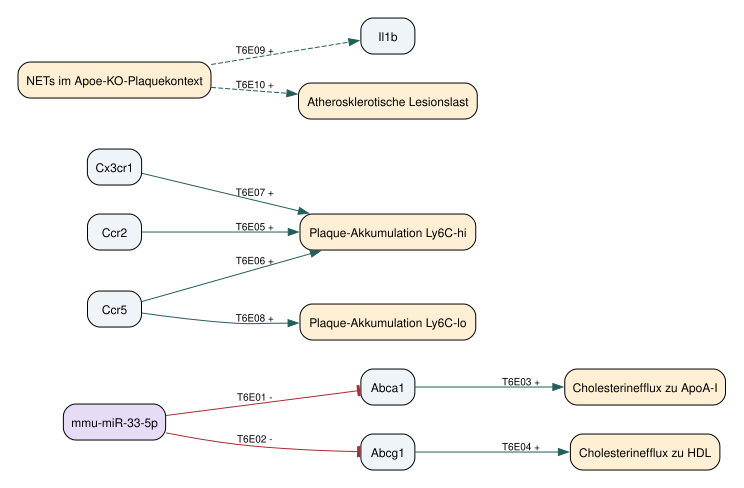

## Ergebnis und Modellgrenze

Für die Maus wurde ein statisches, quellenbasiertes Netzwerk mit **13 Knoten und 10 gerichteten Kanten** erstellt. Es verbindet miRNA-regulierten Cholesterinefflux, Monozyten-Akkumulation und einen neutrophilen Entzündungskontext. Die drei Module bleiben getrennt, weil die ausgewählten Quellen keine durchgehend geprüfte molekulare Verbindung zwischen ihnen liefern. Der Export ist in [JSON](network/network.json), als [Knoten](network/nodes.tsv) und [Kanten](network/edges.tsv) verfügbar.

Eine eigene Auswertung der öffentlichen GSE97310-Matrizen prüft die Anbindung an Transkriptomdaten: Alle sechs proteinkodierenden Netzwerkgene sind in jeder der drei Matrizen eindeutig zuordenbar und mindestens einmal nachgewiesen. Diese technische und deskriptive Prüfung bestätigt weder miRNA-Wirkung noch Kantenkausalität. Es wurden keine eigenen Tierexperimente, keine Differenzialexpressionsanalyse und keine Simulation durchgeführt.

Aufgabe 6 wiederholt die Fragestellung aus Aufgabe 5 für *Mus musculus* und prüft die Übertragbarkeit auf den Menschen. Der Modellumfang ist begrenzt; insbesondere fehlen eine vollständige metabolische Rekonstruktion, ein TF-Netz sowie die systematische Erfassung aller miRNA-Ziele. Damit liegt ein nutzbares und überprüfbares Teilmodell vor, kein vollständiges Zellmodell. Proprietäre SFB1123-Daten standen für diesen Aufgabenteil nicht zur Verfügung.

## 1. Biologischer Kontext

Das primäre Gewebe ist die atherosklerotische Mausaorta. Blutmonozyten, isolierte Makrophagen und Aortenleukozyten werden getrennt annotiert. Die ausgewählten Arbeiten verwenden unter anderem *Apoe*- oder *Ldlr*-defiziente Mäuse; ihre Ergebnisse gehören zu diesen genetischen und ernährungsbezogenen Kontexten. Die Bezeichnung Atherosklerose liefert für sich keine Gleichsetzung mit koronarer Plaqueruptur oder einem klinischen CAD-Endpunkt beim Menschen.

Cochain et al. unterscheiden mittels scRNA-seq residentenähnliche Makrophagen, eine *Il1b*-reiche entzündliche Population und TREM2-hohe Makrophagen mit einem lipidbezogenen Transkriptionsprofil. TREM2 wurde auch in humanen Läsionsmakrophagen gefunden. Das spricht für vergleichbare Zellzustände, beweist aber keine identischen regulatorischen Kanten oder Funktionen. Ein einzelner Marker reicht für eine Zelltypzuordnung nicht aus. ([Cochain et al. 2018](https://pubmed.ncbi.nlm.nih.gov/29545365/))

Für Monozyten zeigt Tacke et al. kontextabhängige Rezeptoranforderungen: Die Plaque-Akkumulation von Ly6C-hohen Zellen hängt von CCR2, CCR5 und CX3CR1 ab; Ly6C-niedrige Zellen zeigen eine teilweise CCR5-Abhängigkeit. Das Netzwerk speichert diese Befunde als Auswirkungen auf Akkumulation. Es interpretiert die Rezeptoren weder als Transkriptionsfaktoren noch als alleinige Determinanten der Zellzahl. ([Tacke et al. 2007](https://www.jci.org/articles/view/28549))

Die NET-Befunde von Warnatsch et al. verbinden neutrophile Strukturen mit IL-1β und Läsionslast im *Apoe*-defizienten Mausmodell. Die mechanistischen Priming-Assays der Arbeit verwenden jedoch humane Blutmonozyten. Deshalb tragen die beiden murinen NET-Kanten ausdrücklich die Evidenzklasse `indirect in vivo perturbation evidence`; sie behaupten keine direkte Bindung an einen murinen Rezeptor. ([Warnatsch et al. 2015, Abb. 2 und 3](https://pmc.ncbi.nlm.nih.gov/articles/PMC4854322/))

## 2. Ressourcen und Daten

| Ressource | Verwendung in dieser Arbeit | Grenze |
|---|---|---|
| NCBI Gene | Speziesgebundene Gene-IDs für sechs Gene | Eine ID identifiziert ein Gen, keine aktive Proteinform |
| miRBase | Reifer Arm `mmu-miR-33-5p`, `MIMAT0000667` | Keine Gleichsetzung mit Vorläufer, 3p-Arm oder humanem miR-33b |
| GEO | Versionsbezogen gesicherte Serienmetadaten und prozessierte GSE97310-Matrizen | Kein kompletter Rohsequenzierungsdownload |
| MGI-Homologie | Geeignete Referenz für den Abgleich orthologer Gene | Orthologie bestätigt keine regulatorische Kante |
| Reactome | Methode für die spätere Pathway-Zuordnung und Expressionsdarstellung | Kein Reactome-Kantenexport wurde importiert |
| miRTarBase | Ressource für experimentell belegte miRNA-Zielkandidaten | Kein pauschaler Import; Assay, Spezies und Zellkontext müssen einzeln geprüft werden |

Die Identitätsquellen sind in `nodes.tsv` verlinkt; der reife miRNA-Arm wurde direkt im [miRBase-Eintrag](https://mirbase.org/mature/MIMAT0000667) geprüft. [MGI](https://www.informatics.jax.org/homology.shtml) stellt Homologieinformationen bereit. Bei einer späteren Reactome-Auswertung ist die Einstellung zur Projektion auf den Menschen entscheidend: Die Dokumentation beschreibt eine standardmäßig aktivierte Humanprojektion. Für eine Maus-Auswertung muss diese Entscheidung ausdrücklich dokumentiert werden. ([Reactome-Handbuch](https://reactome.org/userguide/analysis)) [miRTarBase](https://awi.cuhk.edu.cn/miRTarBase/) wird hier als Suchressource eingeordnet; der Netzwerknachweis stammt aus den Primärarbeiten.

### Verifizierte Datensätze

| Accession | Material und Messung | Tatsächlich bearbeitet |
|---|---|---|
| [GSE97310](https://www.ncbi.nlm.nih.gov/geo/query/acc.cgi?acc=GSE97310) | Maus; CD45-positive Aortenzellen; Einzelzell-RNA-seq; Kontrollkontext sowie 11 und 20 Wochen HFD | Serien-SOFT, README und `GSE97310_10X_Matrices_CircRes2018.tar.gz` heruntergeladen; drei Matrizen vollständig eingelesen |
| [GSE17256](https://www.ncbi.nlm.nih.gov/geo/query/acc.cgi?acc=GSE17256) | Maus; sortierte Blutmonozyten; Affymetrix; zwei Subsets mit je vier biologischen Replikaten, laut Metadaten jeweils aus fünf Mäusen gepoolt | Serien-SOFT gesichert; keine Microarray-Neuauswertung |
| [GSE18565](https://www.ncbi.nlm.nih.gov/geo/query/acc.cgi?acc=GSE18565) | Mensch; Blutmonozyten-Subsets; Affymetrix; drei Spender mit je zwei Subsets | Serien-SOFT gesichert; Vergleichsreferenz, kein CAD-Plaquedatensatz |

Die beiden letzten Serien gehören zu Ingersoll et al. und sind ein direkter Vergleich von Monozyten-Subsets unter den dort untersuchten Bedingungen. Sie sind keine gepaarten Maus-Mensch-Plaquemessungen. Die lokalen SOFT-Dateien enthalten die Zuordnung zu PMID19965649. ([Ingersoll et al. 2010](https://pubmed.ncbi.nlm.nih.gov/19965649/))

Bulk-Proteomik könnte Proteinabundanzen an die Genknoten anbinden; dabei müssen Protein-zu-Gen-Mehrdeutigkeiten erhalten bleiben. Mikroskopie und räumliche Daten wären für die Lokalisation von NETs und Makrophagen informativer als eine reine Genliste. Im vorliegenden Datenbestand wurden solche Messungen nur anhand der publizierten Befunde beurteilt. Reife miRNAs werden durch die hier ausgewerteten mRNA-Matrizen nicht als entsprechender Assay erfasst; ein fehlender miRNA-Count wäre daher kein Nachweis biologischer Abwesenheit.

## 3. Das exportierte Netzwerk

{#fig-network width=100%}

| Kanten | Aussage | Evidenz und Kontext |
|---|---|---|
| T6E01, T6E02 | miR-33-5p hemmt die Expression von Abca1 bzw. Abcg1 | Maus-Makrophagen und ergänzende 3'-UTR-Reporter; Rayner 2010 |
| T6E03, T6E04 | Abca1 unterstützt Efflux zu ApoA-I, Abcg1 zu HDL | Funktionelle Abstraktion des Cholesterineffluxes; Rayner 2010 |
| T6E05 bis T6E07 | Ccr2, Ccr5, Cx3cr1 unterstützen Akkumulation Ly6C-hoher Monozyten | Rezeptorperturbation und Zellverfolgung im Mausmodell; Tacke 2007 |
| T6E08 | Ccr5 unterstützt Akkumulation Ly6C-niedriger Monozyten | Teilweise Abhängigkeit; Tacke 2007 |
| T6E09, T6E10 | NET-Kontext unterstützt Il1b-Expression und Läsionslast | Indirekte in-vivo-Befunde; Warnatsch 2015 |

Rayner et al. zeigen miR-33-abhängige Regulation von ABCA1 in Maus und Mensch. Für ABCG1 ist der Befund speziesabhängig: Die Mausregulation darf nicht auf humanes ABCG1 übertragen werden. Die historische Bezeichnung `miR-33` wurde im Export als 5p-Arm normalisiert; die Originalbezeichnung und die Grenze dieser Normalisierung bleiben in der Kantenannotation erhalten. ([Rayner et al. 2010](https://pubmed.ncbi.nlm.nih.gov/20466885/))

`gene_product` fasst Gen- und Proteinidentität zusammen. Das ist für die Anbindung von Genlisten praktisch, trennt aber weder Transkripte noch Proteinmodifikationen. Die sechs `TASK6:`-Knoten sind lokale Prozessdefinitionen mit stabilen Kennungen innerhalb dieser Version. Sie sind keine externen Ontologie-IDs. Jede Kante enthält Spezies, Zellkontext, Relation, Vorzeichen, PMID, Quellenlink, Fundstelle und eine Einschränkung. Ein positives Vorzeichen bedeutet ausschließlich einen positiven Einfluss auf den genannten Endpunkt im belegten Kontext. Es bedeutet weder generell "entzündungsfördernd" noch "klinisch schädlich".

Die Quellstudien kombinieren unterschiedliche Assays. Eine funktionelle Effluxkante ist deshalb von einer Expressionsrepression getrennt. NET-Perturbationen können weitere Prozesse beeinflussen; auch DNase ist kein vollkommen spezifischer NET-Schalter. Die graphische Nähe zweier Knoten schafft keine zusätzliche Evidenz.

## 4. Eigene Datenanbindung an GSE97310

Das Skript [build_network.py](scripts/build_network.py) liest die Dateien direkt aus dem archivierten TAR.GZ ein. Für jedes der sechs Netzwerkgene muss das Gensymbol in `genes.tsv` genau einmal vorkommen. Die zugehörige Ensembl-ID wird mitgeschrieben. Anschließend werden Matrixdimensionen, Barcodezahl und die Zahl der Sparse-Einträge gegeneinander geprüft. Die Auswertung zählt je Gen die positiven Barcodes und die Summe der gespeicherten Counts.

| Matrix laut Archiv | Features | Barcodes | Nichtnull-Einträge |
|---|---:|---:|---:|
| healthy_aorta | 27.998 | 401 | 619.350 |
| 11weeks_HFD | 27.998 | 956 | 1.925.549 |
| 20weeks_HFD | 27.998 | 1.219 | 972.060 |

Das sind selbst berechnete Dateistatistiken der drei prozessierten Matrizen, keine Zahlen biologischer Replikate. Die GEO-Serie enthält darüber hinaus fünf Sample-Accessions und zwei Plattformkennungen. Die drei Matrizen werden daher nicht mit sämtlichen Proben der Serie gleichgesetzt.

| Gen | Positive Barcodes healthy / 401 | 11 Wochen / 956 | 20 Wochen / 1.219 |
|---|---:|---:|---:|
| Abca1 | 51 | 270 | 253 |
| Abcg1 | 47 | 383 | 141 |
| Ccr2 | 87 | 508 | 324 |
| Ccr5 | 40 | 370 | 186 |
| Cx3cr1 | 35 | 274 | 168 |
| Il1b | 45 | 601 | 576 |

Alle 18 Gen-Matrix-Paare sind nachgewiesen. [data_coverage.tsv](network/data_coverage.tsv) enthält auch die Count-Summen und Nachweisanteile. Die Barcodes stammen aus gemischten Aortenleukozyten. Unterschiede können durch Zellzusammensetzung, Sequenziertiefe, technische Aufbereitung und biologische Zustände entstehen. Aus diesen Zählwerten wird daher weder ein Fold Change noch eine miRNA-vermittelte Regulation abgeleitet. Die Rechnung prüft die praktische Anschlussfähigkeit des Netzwerks an einen realen Datensatz.

Eine spätere Hypothesenprüfung müsste Tiere bzw. unabhängige Pools als Replikationseinheiten verwenden, Zellzustände getrennt analysieren und RNA- mit Proteinbefunden verbinden. Für miRNA-Wirkung wären insbesondere passende reife-miRNA-Messungen und Zielregulation im selben Kontext nötig. Eine inverse Korrelation allein genügt nicht.

## 5. Mensch und Maus: was bleibt, was unterscheidet sich?

| Gegenstand | Gemeinsamkeit | Grenze der Übertragung |
|---|---|---|
| Cholesterinefflux | ABCA1-Regulation durch miR-33 ist in beiden Spezies experimentell untersucht | Die Maus-Abcg1-Kante ist keine humane ABCG1-Kante; 3'-UTRs und Zielstellen müssen geprüft werden |
| miR-33-Familie | miR-33 ist mit dem SREBF2/Srebf2-Kontext verbunden | Menschen besitzen zusätzlich miR-33b; gewöhnliche Mäuse bilden diesen Faktor nicht ab |
| Blutmonozyten | Expressionsvergleiche stützen verwandte klassische und nichtklassische Subsets | Ly6C-Marker lassen sich nicht einfach in CD14/CD16 umbenennen; die humane intermediäre Population braucht eine eigene Definition |
| Makrophagenzustände | Lipidbezogene und entzündliche Zustände liefern vergleichbare funktionelle Themen | Ein ähnlicher Clustername ist kein Beweis identischer Zellherkunft, Regulation oder Krankheitswirkung |
| NET/IL-1β | Die ausgewählte Arbeit kombiniert murine Läsionsbefunde mit humanen Zellassays | Die Evidenzebenen müssen pro Kante getrennt bleiben; Priming und reife Zytokinfreisetzung sind verschiedene Endpunkte |
| Gewebe und Erkrankung | Atherosklerotische Läsionen enthalten Immunzellprogramme | Mausaorta, humane Karotisplaque, Koronararterie und Blut sind verschiedene Kompartimente; klinisches CAD-Risiko ist kein direktes Netzergebnis |

Die miR-33b-Differenz und die Grenze der ABCG1-Übertragung werden auch in der Primärstudie zur Verbindung von Lipidtransport und angeborener Immunantwort ausdrücklich diskutiert. ([Lai et al. 2016](https://pmc.ncbi.nlm.nih.gov/articles/PMC5016698/)) Der Monozytenvergleich beruht auf [Ingersoll et al.](https://pubmed.ncbi.nlm.nih.gov/19965649/); die Unterscheidung dreier humaner Subsets auf [Wong et al. 2011](https://pubmed.ncbi.nlm.nih.gov/21653326/).

Für die Verknüpfung mit [Aufgabe 5](../task5/task5.html) sind `NCBIGene:11303` (Maus-Abca1) und `NCBIGene:19` (humanes ABCA1) entsprechende Genidentitäten; die miRNA-Knoten bleiben `MIMAT0000667` bzw. `MIMAT0000091`. Diese Zuordnung ersetzt keine speziesbezogene Quellenprüfung. Ein gemeinsamer Knotenname würde die belegte ABCG1-Differenz verdecken und wird deshalb vermieden.

## 6. Recherche und Informationsgewinnung

Die Recherche am 23.09.2026 war gezielt und PRISMA-orientiert dokumentiert. Sie erhebt keinen Anspruch auf eine vollständige systematische Review. Suchausdrücke, Quellenzugänge und Entscheidungen liegen in [search_log.tsv](research/search_log.tsv) und [candidates.tsv](research/candidates.tsv). Dokumentiert sind die tatsächlich für die Kuration betrachteten Kandidaten; die wechselnden Gesamtzahlen einer Websuche wurden nicht als systematische Trefferzahl ausgegeben.

Aufgenommen wurden Primärarbeiten mit Mausbezug zur Atherosklerose, einer prüfbaren miRNA-Zielbeziehung oder einem direkten Speziesvergleich. Reviews und Arbeiten zu anderen Erkrankungen wurden für die Kanten ausgeschlossen. Der Screening-Datensatz enthält zehn Kandidaten: drei Kantenquellen, vier Kontextquellen und drei nicht eingeschlossene Arbeiten. Die Auswahl erfolgte LLM-unterstützt ohne unabhängigen zweiten Reviewer. Eine Retrieval- oder Extraktionsgenauigkeit wurde nicht gemessen.

Die Kuration trennt Fundstellen von Interpretation. Ein LLM kann Kandidaten als Tupel `(Quelle, Spezies, Zelle, Subjekt, Relation, Objekt, Assay)` vorschlagen. Die vorliegende Arbeit hat diese Struktur in JSON/TSV umgesetzt und die ausgewählten Behauptungen mit Abstracts bzw. zugänglichen Volltextpassagen abgeglichen. Die technische Prüfung kontrolliert die Struktur, keine biologische Wahrheit. Automatisches Ergänzen von Vorzeichen, Speziestransfer aus Genorthologie oder Kanten aus bloßer Koerwähnung ist ausgeschlossen.

## 7. Nutzbarkeit und Reproduktion

Für RNA- oder Proteomdaten erlaubt das Netz eine nachvollziehbare Zuordnung zu den drei Modulen und den jeweiligen Quellen. Ein vollständiger GSEA-Hintergrund ist es nicht: Sechs gezielt ausgewählte Gene sind eine durch die Fragestellung verzerrte Auswahl. Eine ORA auf diesen sechs Genen würde die Auswahlentscheidung weitgehend wiederholen. Geeigneter wären für eine spätere Anreicherung breit definierte, versionsfixierte Pathways und alle im jeweiligen Assay prüfbaren Gene als Hintergrund.

Eine FBA ist mit diesem Graphen nicht definiert. Es fehlen stöchiometrische Reaktionen, Kompartimente, Austauschreaktionen und Flussgrenzen. Auch Petri-Netz-Invarianten verlangen eine präzise Übergangssemantik. Für ODEs fehlen Raten, Mengen, Zeitreihen und die Identifizierbarkeit der Parameter. Daher werden hier keine Kurven mit frei erfundenen Parametern als biologische Vorhersagen gezeigt.

Die Ausführung erfolgt aus dem Projektwurzelverzeichnis:

```bash
python part1/task6/scripts/build_network.py
quarto render part1/task6/task6.qmd --no-execute
```

Benötigt werden Python 3 mit Standardbibliothek, Graphviz (`dot`) und Quarto. Die Eingabematrizen und Serienmetadaten liegen lokal in `sources/`; die Auswertung benötigt nach dem Download kein Netzwerk. Der Code erzeugt Netzwerkexporte, SVG und Abdeckungstabellen neu. [validation.json](network/validation.json) protokolliert die strukturellen Prüfungen; [SHA256SUMS](SHA256SUMS) fixiert den verwendeten Datenbestand und die exportierten Ergebnisse. Ein erfolgreicher Render bestätigt das Dokumentformat, keine experimentelle Validierung.
