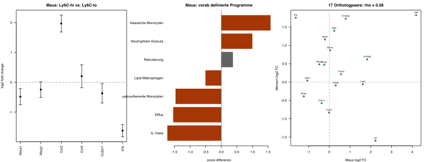

## Ergebnis und Modellgrenze

Für die Maus wurde ein statisches, quellenbasiertes Netzwerk mit 13 Knoten und 10 gerichteten Kanten erstellt. Es verbindet miRNA-regulierten Cholesterinefflux, Monozyten-Akkumulation und einen neutrophilen Entzündungskontext. Die drei Module bleiben getrennt, weil die ausgewählten Quellen keine durchgehend geprüfte molekulare Verbindung zwischen ihnen liefern. Der Export ist in [JSON](network/network.json), als [Knoten](network/nodes.tsv) und [Kanten](network/edges.tsv) verfügbar.

Die quantitative Analyse hat zwei Teile. GSE17256 enthält vier unabhängige Maus-Pools pro Monozyten-Subset; GSE18565 enthält drei menschliche Spender mit beiden Subsets. In diesen Daten wurden die sechs Netzwerkgene und sieben vorab definierte Genprogramme mit einem blockierten `limma`-Modell verglichen. Ccr2 war in murinen Ly6C-hohen Monozyten höher exprimiert (log2-Fold-Change 1,97; FDR 0,000040), Cx3cr1 niedriger (−0,37; FDR 0,044) und Il1b ebenfalls niedriger (−1,62; FDR 0,000031). Die drei GSE97310-Matrizen sind dagegen aggregierte Bedingungen ohne Tier-Replikate. Sie wurden nur deskriptiv ausgewertet; Zellbarcodes wurden nicht als biologische Replikate behandelt.

Der direkte Vergleich von 17 in beiden Arrays messbaren und über NCBI bestätigten Orthologpaaren ergab keine gemeinsame Rangordnung der Subset-Effekte (Spearman-Rho 0,078; p = 0,765; 9 von 17 Richtungen gleich). Das Ergebnis begrenzt den Speziestransfer klar. Die Daten stammen aus Blutmonozyten gesunder Tiere und Menschen, nicht aus gepaarten Atherosklerose-Läsionen. Expressionsunterschiede prüfen außerdem keine Kantenkausalität. Proprietäre SFB1123-Daten standen für diesen Aufgabenteil nicht zur Verfügung.

## 1. Biologischer Kontext

Das primäre Gewebe ist die atherosklerotische Mausaorta. Blutmonozyten, isolierte Makrophagen und Aortenleukozyten werden getrennt annotiert. Die ausgewählten Arbeiten verwenden unter anderem *Apoe*- oder *Ldlr*-defiziente Mäuse; ihre Ergebnisse gehören zu diesen genetischen und ernährungsbezogenen Kontexten. Die Bezeichnung Atherosklerose liefert für sich keine Gleichsetzung mit koronarer Plaqueruptur oder einem klinischen CAD-Endpunkt beim Menschen.

Cochain et al. unterscheiden mittels scRNA-seq residentenähnliche Makrophagen, eine *Il1b*-reiche entzündliche Population und TREM2-hohe Makrophagen mit einem lipidbezogenen Transkriptionsprofil. TREM2 wurde auch in humanen Läsionsmakrophagen gefunden. Das spricht für vergleichbare Zellzustände, beweist aber keine identischen regulatorischen Kanten oder Funktionen. Ein einzelner Marker reicht für eine Zelltypzuordnung nicht aus. ([Cochain et al. 2018](https://pubmed.ncbi.nlm.nih.gov/29545365/))

Für Monozyten zeigt Tacke et al. kontextabhängige Rezeptoranforderungen: Die Plaque-Akkumulation von Ly6C-hohen Zellen hängt von CCR2, CCR5 und CX3CR1 ab; Ly6C-niedrige Zellen zeigen eine teilweise CCR5-Abhängigkeit. Das Netzwerk speichert diese Befunde als Auswirkungen auf Akkumulation. Es interpretiert die Rezeptoren weder als Transkriptionsfaktoren noch als alleinige Determinanten der Zellzahl. ([Tacke et al. 2007](https://www.jci.org/articles/view/28549))

Die NET-Befunde von Warnatsch et al. verbinden neutrophile Strukturen mit IL-1β und Läsionslast im *Apoe*-defizienten Mausmodell. Die mechanistischen Priming-Assays der Arbeit verwenden jedoch humane Blutmonozyten. Deshalb tragen die beiden murinen NET-Kanten ausdrücklich die Evidenzklasse `indirect in vivo perturbation evidence`; sie behaupten keine direkte Bindung an einen murinen Rezeptor. ([Warnatsch et al. 2015, Abb. 2 und 3](https://pmc.ncbi.nlm.nih.gov/articles/PMC4854322/))

## 2. Ressourcen und Daten

| Ressource | Verwendung in dieser Arbeit | Grenze |
|---|---|---|
| NCBI Gene | Speziesgebundene Gene-IDs für sechs Gene | Eine ID identifiziert ein Gen, keine aktive Proteinform |
| miRBase | Reifer Arm `mmu-miR-33-5p`, `MIMAT0000667` | Keine Gleichsetzung mit Vorläufer, 3p-Arm oder humanem miR-33b |
| GEO | Serienmetadaten, GSE97310-Countmatrizen sowie GC-RMA-Matrizen und Plattformannotationen für GSE17256/GSE18565 | Die Arrayanalyse beginnt bei den prozessierten Werten, nicht bei CEL-Dateien |
| NCBI Datasets Ortholog-API | 18 vorab ausgewählte Maus-Mensch-Paare, am 24.09.2026 als JSON gesichert | Orthologie bestätigt keine regulatorische Kante; 17 Paare waren in beiden Arrayannotationen eindeutig messbar |
| Reactome | Methode für die spätere Pathway-Zuordnung und Expressionsdarstellung | Kein Reactome-Kantenexport wurde importiert |
| miRTarBase | Ressource für experimentell belegte miRNA-Zielkandidaten | Kein pauschaler Import; Assay, Spezies und Zellkontext müssen einzeln geprüft werden |

Die Identitätsquellen sind in `nodes.tsv` verlinkt; der reife miRNA-Arm wurde direkt im [miRBase-Eintrag](https://mirbase.org/mature/MIMAT0000667) geprüft. Die tatsächlich verwendeten Orthologantworten liegen in `sources/ncbi_selected_orthologs.json`. Bei einer späteren Reactome-Auswertung ist die Einstellung zur Projektion auf den Menschen entscheidend: Die Dokumentation beschreibt eine standardmäßig aktivierte Humanprojektion. Für eine Maus-Auswertung muss diese Entscheidung ausdrücklich dokumentiert werden. ([Reactome-Handbuch](https://reactome.org/userguide/analysis)) [miRTarBase](https://awi.cuhk.edu.cn/miRTarBase/) wird hier als Suchressource eingeordnet; der Netzwerknachweis stammt aus den Primärarbeiten.

### Verifizierte Datensätze

| Accession | Material und Messung | Tatsächlich bearbeitet |
|---|---|---|
| [GSE97310](https://www.ncbi.nlm.nih.gov/geo/query/acc.cgi?acc=GSE97310) | Maus; CD45-positive Aortenzellen; Einzelzell-RNA-seq; Kontrollkontext sowie 11 und 20 Wochen HFD | Serien-SOFT, README und `GSE97310_10X_Matrices_CircRes2018.tar.gz` heruntergeladen; drei Matrizen vollständig eingelesen |
| [GSE17256](https://www.ncbi.nlm.nih.gov/geo/query/acc.cgi?acc=GSE17256) | Maus; sortierte Blutmonozyten; Affymetrix; zwei Subsets mit je vier biologischen Replikaten, laut Metadaten jeweils aus fünf Mäusen gepoolt | GC-RMA-Serienmatrix und GPL1261-Annotation vollständig analysiert |
| [GSE18565](https://www.ncbi.nlm.nih.gov/geo/query/acc.cgi?acc=GSE18565) | Mensch; Blutmonozyten-Subsets; Affymetrix; drei Spender mit je zwei Subsets | GC-RMA-Serienmatrix und GPL570-Annotation vollständig analysiert; Vergleichsreferenz, kein CAD-Plaquedatensatz |

Die beiden letzten Serien gehören zu Ingersoll et al. und sind ein direkter Vergleich von Monozyten-Subsets unter den dort untersuchten Bedingungen. Sie sind keine gepaarten Maus-Mensch-Plaquemessungen. Die lokalen SOFT-Dateien enthalten die Zuordnung zu PMID19965649. ([Ingersoll et al. 2010](https://pubmed.ncbi.nlm.nih.gov/19965649/))

Bulk-Proteomik könnte Proteinabundanzen an die Genknoten anbinden; dabei müssen Protein-zu-Gen-Mehrdeutigkeiten erhalten bleiben. Mikroskopie und räumliche Daten wären für die Lokalisation von NETs und Makrophagen informativer als eine reine Genliste. Im vorliegenden Datenbestand wurden solche Messungen nur anhand der publizierten Befunde beurteilt. Reife miRNAs werden durch die hier ausgewerteten mRNA-Matrizen nicht als entsprechender Assay erfasst; ein fehlender miRNA-Count wäre daher kein Nachweis biologischer Abwesenheit.

## 3. Das exportierte Netzwerk

{#fig-network width=100%}

| Kanten | Aussage | Evidenz und Kontext |
|---|---|---|
| T6E01, T6E02 | miR-33-5p hemmt die Expression von Abca1 bzw. Abcg1 | Maus-Makrophagen und ergänzende 3'-UTR-Reporter; Rayner 2010 |
| T6E03, T6E04 | Abca1 unterstützt Efflux zu ApoA-I, Abcg1 zu HDL | Funktionelle Abstraktion des Cholesterineffluxes; Rayner 2010 |
| T6E05 bis T6E07 | Ccr2, Ccr5, Cx3cr1 unterstützen Akkumulation Ly6C-hoher Monozyten | Rezeptorperturbation und Zellverfolgung im Mausmodell; Tacke 2007 |
| T6E08 | Ccr5 unterstützt Akkumulation Ly6C-niedriger Monozyten | Teilweise Abhängigkeit; Tacke 2007 |
| T6E09, T6E10 | NET-Kontext unterstützt Il1b-Expression und Läsionslast | Indirekte in-vivo-Befunde; Warnatsch 2015 |

Rayner et al. zeigen miR-33-abhängige Regulation von ABCA1 in Maus und Mensch. Für ABCG1 ist der Befund speziesabhängig: Die Mausregulation darf nicht auf humanes ABCG1 übertragen werden. Die historische Bezeichnung `miR-33` wurde im Export als 5p-Arm normalisiert; die Originalbezeichnung und die Grenze dieser Normalisierung bleiben in der Kantenannotation erhalten. ([Rayner et al. 2010](https://pubmed.ncbi.nlm.nih.gov/20466885/))

`gene_product` fasst Gen- und Proteinidentität zusammen. Das ist für die Anbindung von Genlisten praktisch, trennt aber weder Transkripte noch Proteinmodifikationen. Die sechs `TASK6:`-Knoten sind lokale Prozessdefinitionen mit stabilen Kennungen innerhalb dieser Version. Sie sind keine externen Ontologie-IDs. Jede Kante enthält Spezies, Zellkontext, Relation, Vorzeichen, PMID, Quellenlink, Fundstelle und eine Einschränkung. Ein positives Vorzeichen bedeutet ausschließlich einen positiven Einfluss auf den genannten Endpunkt im belegten Kontext. Es bedeutet weder generell "entzündungsfördernd" noch "klinisch schädlich".

Die Quellstudien kombinieren unterschiedliche Assays. Eine funktionelle Effluxkante ist deshalb von einer Expressionsrepression getrennt. NET-Perturbationen können weitere Prozesse beeinflussen; auch DNase ist kein vollkommen spezifischer NET-Schalter. Die graphische Nähe zweier Knoten schafft keine zusätzliche Evidenz.

## 4. Quantitative Datenanalyse

### 4.1 GSE97310: deskriptive Anbindung ohne Pseudoreplikation

Die drei 10X-Matrizen enthalten je eine aggregierte Bedingung. Aus den lokalen GEO-Unterlagen lässt sich keine Tier-ID pro Barcode rekonstruieren. Ein Test über Barcodes würde die Stichprobengröße künstlich erhöhen. Deshalb berechnen [build_network.py](scripts/build_network.py) und [analyze_gse97310.py](scripts/analyze_gse97310.py) ausschließlich Dateistatistiken, Summen, Nachweisanteile und bibliotheksgrößen-normalisierte Counts. Es gibt für GSE97310 keinen p-Wert.

| Matrix laut Archiv | Features | Barcodes | Nichtnull-Einträge |
|---|---:|---:|---:|
| healthy_aorta | 27.998 | 401 | 619.350 |
| 11weeks_HFD | 27.998 | 956 | 1.925.549 |
| 20weeks_HFD | 27.998 | 1.219 | 972.060 |

Das sind selbst berechnete Dateistatistiken der drei prozessierten Matrizen. Jede Matrix hat für diese Auswertung genau eine biologische Replikationseinheit. Die GEO-Serie enthält darüber hinaus fünf Sample-Accessions und zwei Plattformkennungen; die drei Matrizen werden daher nicht mit sämtlichen Proben der Serie gleichgesetzt.

| Gen | Positive Barcodes healthy / 401 | 11 Wochen / 956 | 20 Wochen / 1.219 |
|---|---:|---:|---:|
| Abca1 | 51 | 270 | 253 |
| Abcg1 | 47 | 383 | 141 |
| Ccr2 | 87 | 508 | 324 |
| Ccr5 | 40 | 370 | 186 |
| Cx3cr1 | 35 | 274 | 168 |
| Il1b | 45 | 601 | 576 |

Alle 18 Gen-Matrix-Paare sind nachgewiesen. [data_coverage.tsv](network/data_coverage.tsv) enthält Count-Summen und Nachweisanteile. Die erweiterte Tabelle [gse97310_selected_gene_counts.tsv](analysis/gse97310_selected_gene_counts.tsv) erfasst 26 Gene aus Efflux-, Monozyten-, Makrophagen- und Neutrophilenprogrammen. [gse97310_program_summary.tsv](analysis/gse97310_program_summary.tsv) fasst sie als mittleren `log(1 + CPM)`-Wert zusammen. Diese Werte sind explorativ. Die Barcodes stammen aus gemischten Aortenleukozyten; Zellzusammensetzung, Sequenziertiefe, technische Aufbereitung und biologischer Zustand sind nicht getrennt. Daher werden weder Fold Changes noch Zellanteile oder miRNA-Wirkungen abgeleitet.

### 4.2 GSE17256 und GSE18565: Analyse mit biologischen Replikaten

Ingersoll et al. sortierten murine Gr1/Ly6C-hohe und Gr1/Ly6C-niedrige Blutmonozyten. Vier getrennte Sortierungen bilden vier biologische Replikate; jede beruht laut GEO auf einem Pool aus fünf Mäusen. Die humane Serie enthält CD16-negative und CD16-positive Monozyten aus drei Spendern. Die parallel nummerierten Sample-Titel wurden als gemeinsame Sortierung bzw. gemeinsamer Spender interpretiert und im Hauptmodell blockiert. Eine Sensitivitätsanalyse ohne Block lieferte bei allen 56 geprüften Gen- und Programmeffekten dieselbe Effektrichtung.

Die GEO-Matrizen enthalten die von den Autoren GC-RMA-normalisierten Werte. [analyze_monocyte_arrays.R](scripts/analyze_monocyte_arrays.R) log2-transformiert diese Werte, passt pro Probe-Set ein lineares Modell mit `limma` an und verwendet den Kontrast klassisch minus nichtklassisch. Die Benjamini-Hochberg-Korrektur umfasst je Spezies alle 45.101 bzw. 54.675 Probe-Sets. 7.537 murine und 8.693 humane Probe-Sets lagen bei FDR < 0,05. Diese großen Zahlen beschreiben primär verschiedene Monozyten-Identitäten; sie sind kein Atherosklerosekontrast.

Für die gezielte Genanalyse wurden alle eindeutig einem Symbol zugeordneten Probe-Sets auf der log2-Skala gemittelt. Die FDR-Spalte der folgenden Tabelle korrigiert die vorab ausgewählten murinen Gene. Positive Werte bedeuten höhere Expression in Ly6C-hohen Monozyten.

| Netzgen | log2-FC | 95-%-KI | FDR |
|---|---:|---:|---:|
| Abca1 | −0,483 | −0,753 bis −0,213 | 0,0083 |
| Abcg1 | −0,246 | −0,509 bis 0,017 | 0,0799 |
| Ccr2 | 1,969 | 1,686 bis 2,252 | 0,000040 |
| Ccr5 | 0,201 | −0,181 bis 0,583 | 0,2642 |
| Cx3cr1 | −0,370 | −0,694 bis −0,045 | 0,0443 |
| Il1b | −1,621 | −1,827 bis −1,415 | 0,000031 |

Die Rezeptormuster passen teilweise zur erwarteten Subset-Trennung: Ccr2 ist in Ly6C-hohen, Cx3cr1 in Ly6C-niedrigen Zellen stärker. Ccr5 liefert in diesen Blutdaten keinen gesicherten Unterschied. Il1b ist in den Ly6C-hohen Proben niedriger. Das widerspricht keiner NET-Kante im Netzwerk, weil jene Kante einen aortalen Plaque- und Perturbationskontext beschreibt, während GSE17256 unstimulierte Blutmonozyten misst.

Sieben vorab festgelegte Programme wurden als Mittel der innerhalb eines Datensatzes z-standardisierten Genexpression berechnet. Das klassische Monozytenprogramm war in Ly6C-hohen Zellen höher (Score-Differenz 1,577; FDR 1,3 × 10^-9^), das patrouillierende Programm niedriger (−1,464; FDR 1,2 × 10^-6^). Das neutrophile Granulaprogramm war ebenfalls höher (0,995; FDR 1,2 × 10^-6^). Das ist ein Expressionsprogramm in sortierten Monozyten und keine Schätzung einer Neutrophilenbeimischung. Das Rekrutierungsprogramm aus Ccr2, Ccr5 und Cx3cr1 erreichte FDR 0,097.

{#fig-quantitative width=100%}

Alle Einzelwerte stehen in [selected_gene_results.tsv](analysis/selected_gene_results.tsv), [program_tests.tsv](analysis/program_tests.tsv) und den komprimierten Probe-Tabellen im Analyseordner. Die Konfidenzintervalle verwenden die moderierte Restvarianz des `limma`-Modells. Sie erfassen keine Unsicherheit aus der Plattformannotation oder der Auswahl der Programme.

## 5. Mensch und Maus: was bleibt, was unterscheidet sich?

| Gegenstand | Gemeinsamkeit | Grenze der Übertragung |
|---|---|---|
| Cholesterinefflux | ABCA1-Regulation durch miR-33 ist in beiden Spezies experimentell untersucht | Die Maus-Abcg1-Kante ist keine humane ABCG1-Kante; 3'-UTRs und Zielstellen müssen geprüft werden |
| miR-33-Familie | miR-33 ist mit dem SREBF2/Srebf2-Kontext verbunden | Menschen besitzen zusätzlich miR-33b; gewöhnliche Mäuse bilden diesen Faktor nicht ab |
| Blutmonozyten | Expressionsvergleiche stützen verwandte klassische und nichtklassische Subsets | Ly6C-Marker lassen sich nicht einfach in CD14/CD16 umbenennen; die humane intermediäre Population braucht eine eigene Definition |
| Makrophagenzustände | Lipidbezogene und entzündliche Zustände liefern vergleichbare funktionelle Themen | Ein ähnlicher Clustername ist kein Beweis identischer Zellherkunft, Regulation oder Krankheitswirkung |
| NET/IL-1β | Die ausgewählte Arbeit kombiniert murine Läsionsbefunde mit humanen Zellassays | Die Evidenzebenen müssen pro Kante getrennt bleiben; Priming und reife Zytokinfreisetzung sind verschiedene Endpunkte |
| Gewebe und Erkrankung | Atherosklerotische Läsionen enthalten Immunzellprogramme | Mausaorta, humane Karotisplaque, Koronararterie und Blut sind verschiedene Kompartimente; klinisches CAD-Risiko ist kein direktes Netzergebnis |

Der eigene Arrayvergleich macht diese Grenze messbar. Im humanen Kontrast CD16-negativ minus CD16-positiv waren CCR2 (log2-FC 4,36), CCR5 (0,79) und CX3CR1 (−0,58) ähnlich gerichtet wie die entsprechenden murinen Subset-Marker. ABCA1, ABCG1 und IL1B waren dagegen positiv, während die murinen Effekte negativ waren. Für den formal begrenzten Vergleich wurden 18 Maus-Mensch-Paare am 24.09.2026 über die NCBI-Datasets-Orthologschnittstelle geprüft. 17 davon waren auf beiden Arrays eindeutig messbar. Nur 9 von 17 Effektrichtungen stimmten überein; die Rangkorrelation betrug 0,078 (p = 0,765). Der kleine, hypothesengeleitete Satz erlaubt keine genomeweite Aussage. Er zeigt aber, dass selbst in ähnlich bezeichneten Blutmonozyten-Subsets einzelne Netzwerk- und Immunprogramme nicht durch bloße Orthologie übertragen werden dürfen.

Die miR-33b-Differenz und die Grenze der ABCG1-Übertragung werden auch in der Primärstudie zur Verbindung von Lipidtransport und angeborener Immunantwort ausdrücklich diskutiert. ([Lai et al. 2016](https://pmc.ncbi.nlm.nih.gov/articles/PMC5016698/)) Der Monozytenvergleich beruht auf [Ingersoll et al.](https://pubmed.ncbi.nlm.nih.gov/19965649/); die Unterscheidung dreier humaner Subsets auf [Wong et al. 2011](https://pubmed.ncbi.nlm.nih.gov/21653326/).

Für die Verknüpfung mit [Aufgabe 5](../task5/task5.html) sind `NCBIGene:11303` (Maus-Abca1) und `NCBIGene:19` (humanes ABCA1) entsprechende Genidentitäten; die miRNA-Knoten bleiben `MIMAT0000667` bzw. `MIMAT0000091`. [ortholog_concordance.tsv](analysis/ortholog_concordance.tsv) speichert Gene-IDs, Quellen-URLs und beide Effekte. Ein gemeinsamer Knotenname würde die belegte ABCG1-Differenz verdecken und wird deshalb vermieden.

## 6. Recherche und Informationsgewinnung

Die Recherche am 23.09.2026 war gezielt und PRISMA-orientiert dokumentiert. Sie erhebt keinen Anspruch auf eine vollständige systematische Review. Suchausdrücke, Quellenzugänge und Entscheidungen liegen in [search_log.tsv](research/search_log.tsv) und [candidates.tsv](research/candidates.tsv). Dokumentiert sind die tatsächlich für die Kuration betrachteten Kandidaten; die wechselnden Gesamtzahlen einer Websuche wurden nicht als systematische Trefferzahl ausgegeben.

Aufgenommen wurden Primärarbeiten mit Mausbezug zur Atherosklerose, einer prüfbaren miRNA-Zielbeziehung oder einem direkten Speziesvergleich. Reviews und Arbeiten zu anderen Erkrankungen wurden für die Kanten ausgeschlossen. Der Screening-Datensatz enthält zehn Kandidaten: drei Kantenquellen, vier Kontextquellen und drei nicht eingeschlossene Arbeiten. Die Auswahl erfolgte LLM-unterstützt ohne unabhängigen zweiten Reviewer. Eine Retrieval- oder Extraktionsgenauigkeit wurde nicht gemessen.

Die Kuration trennt Fundstellen von Interpretation. Ein LLM kann Kandidaten als Tupel `(Quelle, Spezies, Zelle, Subjekt, Relation, Objekt, Assay)` vorschlagen. Die vorliegende Arbeit hat diese Struktur in JSON/TSV umgesetzt und die ausgewählten Behauptungen mit Abstracts bzw. zugänglichen Volltextpassagen abgeglichen. Die technische Prüfung kontrolliert die Struktur, keine biologische Wahrheit. Automatisches Ergänzen von Vorzeichen, Speziestransfer aus Genorthologie oder Kanten aus bloßer Koerwähnung ist ausgeschlossen.

## 7. Nutzbarkeit und Reproduktion

Für RNA- oder Proteomdaten erlaubt das Netz eine nachvollziehbare Zuordnung zu den drei Modulen und den jeweiligen Quellen. Ein vollständiger GSEA-Hintergrund ist es nicht: Sechs gezielt ausgewählte Gene sind eine durch die Fragestellung verzerrte Auswahl. Eine ORA auf diesen sechs Genen würde die Auswahlentscheidung weitgehend wiederholen. Geeigneter wären für eine spätere Anreicherung breit definierte, versionsfixierte Pathways und alle im jeweiligen Assay prüfbaren Gene als Hintergrund.

Eine FBA ist mit diesem Graphen nicht definiert. Es fehlen stöchiometrische Reaktionen, Kompartimente, Austauschreaktionen und Flussgrenzen. Auch Petri-Netz-Invarianten verlangen eine präzise Übergangssemantik. Für ODEs fehlen Raten, Mengen, Zeitreihen und die Identifizierbarkeit der Parameter. Daher werden hier keine Kurven mit frei erfundenen Parametern als biologische Vorhersagen gezeigt.

Die Ausführung erfolgt aus dem Projektwurzelverzeichnis:

```bash
python3 -B part1/task6/scripts/fetch_analysis_sources.py
python3 -B part1/task6/scripts/build_network.py
Rscript part1/task6/scripts/analyze_monocyte_arrays.R part1/task6
python3 -B part1/task6/scripts/analyze_gse97310.py
rsvg-convert -w 1656 -o part1/task6/figures/quantitative_results.png \
  part1/task6/figures/quantitative_results.svg
python3 -B part1/task6/scripts/validate_analysis.py
quarto render part1/task6/task6.qmd --no-execute
```

Der erste Aufruf benötigt Netzwerkzugriff auf NCBI. Danach sind die Analysen offline reproduzierbar. Benötigt werden Python 3 mit Standardbibliothek, R 4.6 mit `limma` und `jsonlite`, Graphviz, `rsvg-convert` und Quarto. [source_manifest.tsv](analysis/source_manifest.tsv) fixiert die fünf neu verwendeten Eingaben mit SHA-256, Dateigröße, URL und Datum. [validation.json](analysis/validation.json) prüft Quellenhashes, Replikatstruktur, Ergebnisdimensionen, die ausdrückliche Nullzahl statistischer Tests für GSE97310 und die SVG-Syntax. `session_info.txt` hält die R-Umgebung fest.

Die Analyse beantwortet die Expressionsfrage innerhalb zweier Blutmonozyten-Subsets. Sie testet weder Atherosklerose gegen Kontrolle noch Krankheitsprogression. Die GSE97310-Aggregate können keine Varianz zwischen Tieren liefern. Proteinaktivität, reife miRNA, Zelllokalisation und Flux bleiben ungemessen. Daher werden Expressionsrichtungen nicht als kausale Netzwerkkanten ausgegeben. Eine belastbare Plaqueanalyse bräuchte mehrere Tiere pro Zustand, eine dokumentierte Zelltypzuordnung und idealerweise RNA-, Protein- und miRNA-Messungen aus denselben biologischen Einheiten.
